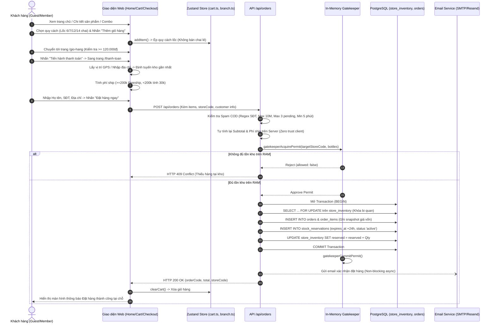
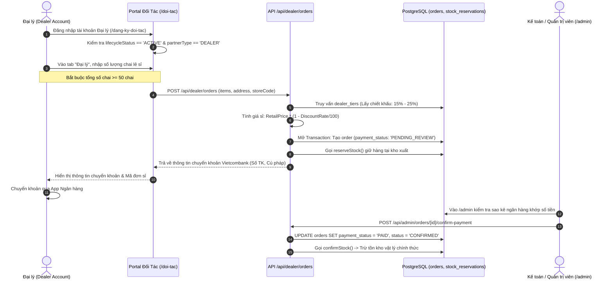
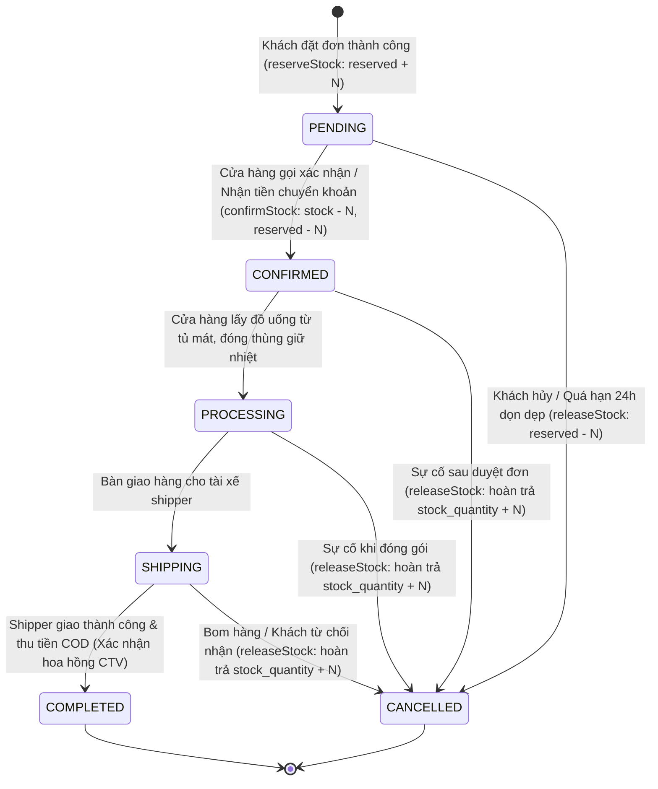
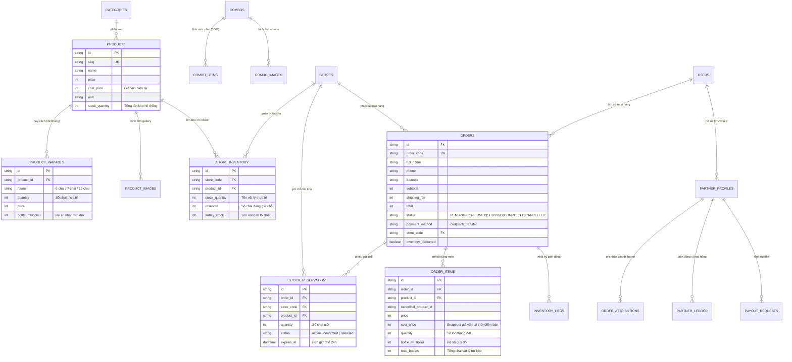

# BÁO CÁO KIỂM TOÁN TOÀN DIỆN LUỒNG BÁN HÀNG VÀ UI/UX HỆ THỐNG THÁI SƠN FOODS
**Mã tài liệu:** `TSF-AUDIT-FLOW-UIUX-2026`  
**Ngày thực hiện:** 13/10/2026  
**Vai trò thẩm định:** Senior Product Engineer & Lead UX Auditor  
**Phạm vi kiểm toán:** Toàn bộ mã nguồn ứng dụng, CSDL PostgreSQL, luồng nghiệp vụ E-Commerce, Multi-Store Inventory, Portal Đối tác và Giao diện Quản trị.  
**Nguyên tắc thực thi:** Chỉ đọc mã nguồn (Read-Only), ghi nhận sự thật khách quan kèm bằng chứng đường dẫn file và số dòng, không suy đoán, không refactor mã nguồn trong giai đoạn này.

---

## MỤC LỤC BÁO CÁO
1. [Bước 1: Tổng quan kỹ thuật](#bước-1-tổng-quan-kỹ-thuật)
2. [Bước 2: Bản đồ màn hình và route](#bước-2-bản-đồ-màn-hình-và-route)
3. [Bước 3: Luồng bán hàng end-to-end](#bước-3-luồng-bán-hàng-end-to-end)
4. [Bước 4: Mô hình dữ liệu và logic nghiệp vụ](#bước-4-mô-hình-dữ-liệu-và-logic-nghiệp-vụ)
5. [Bước 5: Audit UI/UX](#bước-5-audit-uiux)
6. [Bước 6: Danh sách vấn đề (Issues Matrix)](#bước-6-danh-sách-vấn-đề-issues-matrix)
7. [Bước 7: Điểm chưa rõ & Câu hỏi cần làm rõ](#bước-7-điểm-chưa-rõ--câu-hỏi-cần-làm-rõ)
8. [Tóm tắt điều hành (Executive Summary)](#tóm-tắt-điều-hành-executive-summary)

---

## BƯỚC 1: TỔNG QUAN KỸ THUẬT

### 1.1. Công nghệ nền tảng (Technology Stack)
- **Framework & Runtime:** Next.js 16.3.5 (App Router, Turbopack, Standalone SSR/Edge hybrid) chạy trên Node.js v20+ ([package.json:11-13](file:///d:/WebTSF/thai-son-foods/package.json#L11-L13)).
- **Ngôn ngữ:** TypeScript 5.0+ ([tsconfig.json](file:///d:/WebTSF/thai-son-foods/tsconfig.json)).
- **Giao diện & Styling:**
  - React 19.2.8 ([package.json:28-29](file:///d:/WebTSF/thai-son-foods/package.json#L28-L29)).
  - Tailwind CSS v4 (`@tailwindcss/postcss`, `postcss.config.mjs`).
  - Biểu tượng: `lucide-react` v1.16.0.
  - Hiệu ứng & Animation: `framer-motion` v12.38.0, `canvas-confetti` v1.9.4.
  - Typography: Google Fonts tích hợp qua `next/font/google` gồm `Fira_Sans`, `Roboto`, `Playfair_Display` ([src/app/layout.tsx:7-27](file:///d:/WebTSF/thai-son-foods/src/app/layout.tsx#L7-L27)).
- **Quản lý trạng thái (State Management):**
  - Zustand v5.0.11 với middleware `persist` lưu cục bộ vào `localStorage`:
    - `useCartStore`: Key `thai-son-cart` ([src/store/cart.ts:61-63](file:///d:/WebTSF/thai-son-foods/src/store/cart.ts#L61-L63)).
    - `useBranchStore`: Key `thai-son-branch` ([src/store/branch.ts:61-63](file:///d:/WebTSF/thai-son-foods/src/store/branch.ts#L61-L63)).
  - React Context: `LanguageContext` (Đa ngôn ngữ vi/en), `UserAuthContext` (Phiên người dùng), `FlyToCartContext` (Hiệu ứng bay vào giỏ).
- **Backend & API Layer:** Next.js Route Handlers (`src/app/api/*`), Node.js `node:crypto`, bộ đệm in-memory kiểm soát đồng thời ([src/lib/inventoryGatekeeper.ts](file:///d:/WebTSF/thai-son-foods/src/lib/inventoryGatekeeper.ts)).
- **Cơ sở dữ liệu (Database):**
  - Hệ quản trị CSDL: PostgreSQL 16+ (Hỗ trợ cả cụm Neon Cloud Serverless Pooler và Local PostgreSQL).
  - Kết nối trực tiếp: Thư viện `pg` Pool (`PoolClient`) thực thi các truy vấn nguyên tử với cơ chế khóa bi quan `SELECT ... FOR UPDATE` ([src/lib/db.ts:13-43](file:///d:/WebTSF/thai-son-foods/src/lib/db.ts#L13-L43)).
  - ORM / Schema Manager: Prisma 6.5.0 ([prisma/schema.prisma](file:///d:/WebTSF/thai-son-foods/prisma/schema.prisma)).
  - Tổng số bảng thực tế trong CSDL: **37 bảng** (Bao gồm danh mục, sản phẩm, biến thể, combo, đơn hàng, tồn kho chi nhánh, giữ chỗ tồn kho, log kiểm toán, tài khoản đối tác, ví hoa hồng, lịch giao định kỳ, và đánh giá).

---

### 1.2. Cấu trúc thư mục chính và vai trò
```
d:/WebTSF/thai-son-foods/
├── prisma/               # Prisma Schema (schema.prisma) định nghĩa mô hình dữ liệu lõi
├── public/               # Tài nguyên tĩnh: Ảnh sản phẩm, logo, banner, combo, favicon
├── src/
│   ├── app/              # Next.js App Router (Màn hình khách, portal đối tác, admin, route APIs)
│   │   ├── admin/        # Dashboard quản trị tập trung (Overview, Inventory, Orders, Users, Audit...)
│   │   ├── api/          # 35+ API Route Handlers (Auth, Orders, Inventory, Dealer, Partner, Cron...)
│   │   ├── combo/        # Màn hình danh mục combo và chi tiết combo ([slug])
│   │   ├── dai-ly/       # Màn hình đại lý (Bị chuyển hướng trong next.config.ts)
│   │   ├── dang-ky-doi-tac/ # Trang đăng ký & đăng nhập đối tác CTV / Đại lý
│   │   ├── doi-tac/      # Portal đối tác CTV & Đại lý (Ví, đơn hàng affiliate, đặt hàng sỉ)
│   │   ├── gio-hang/     # Trang giỏ hàng chuyên dụng
│   │   ├── member/       # Trang thành viên Thái Sơn Prime (Bị chuyển hướng do feature flag)
│   │   ├── san-pham/     # Chi tiết sản phẩm ([slug]); Route gốc chuyển hướng về /#san-pham
│   │   ├── tai-khoan/    # Quản lý tài khoản khách hàng, lịch sử đơn mua, đánh giá
│   │   ├── test-email/   # Studio kiểm thử giao diện email đặt hàng (Lộ ra ngoài public)
│   │   └── thanh-toan/   # Trang Checkout và xác nhận đặt hàng thành công
│   ├── components/       # Các khối giao diện phân cấp (layout, home, product, cart, checkout...)
│   ├── config/           # Cấu hình tĩnh: INVENTORY_CONFIG, MEMBERSHIP_CONFIG
│   ├── context/          # React Context (Ngôn ngữ, Phiên khách hàng, Hiệu ứng giỏ hàng)
│   ├── data/             # Dữ liệu tĩnh dự phòng: products.ts, combos.ts, vietnam-addresses.ts
│   ├── lib/              # Bộ xử lý nghiệp vụ backend: inventory.ts, rbac.ts, geo.ts, email, partner
│   ├── store/            # State stores Zustand: cart.ts, branch.ts
│   └── types/            # Khai báo kiểu dữ liệu TypeScript dùng chung
```

---

### 1.3. Các Role và Cơ chế Phân quyền (RBAC & Access Control)
Hệ thống thiết lập **5 nhóm vai trò người dùng** với các cơ chế kiểm soát truy cập phân tầng:

| Vai trò (Role) | Định danh phiên | Phạm vi truy cập & Quyền hạn | Bằng chứng mã nguồn |
| :--- | :--- | :--- | :--- |
| **GUEST (Khách vãng lai)** | Không cần phiên | Xem trang chủ, xem sản phẩm/combo, thêm vào giỏ, tạo đơn đặt hàng COD không cần đăng ký. | [src/app/api/orders/route.ts:16-27](file:///d:/WebTSF/thai-son-foods/src/app/api/orders/route.ts#L16-L27) |
| **CUSTOMER (Thành viên)** | Cookie `tsf_user_session` (JWT) | Đăng nhập Google OAuth hoặc mật khẩu, quản lý hồ sơ tại `/tai-khoan`, xem lịch sử đơn mua cá nhân, viết đánh giá sản phẩm. | [src/context/UserAuthContext.tsx](file:///d:/WebTSF/thai-son-foods/src/context/UserAuthContext.tsx), [src/app/tai-khoan/page.tsx:25](file:///d:/WebTSF/thai-son-foods/src/app/tai-khoan/page.tsx#L25) |
| **PARTNER (CTV / DEALER)** | Cookie `tsf_user_session` (JWT) | Truy cập `/doi-tac`, nhận link/mã giới thiệu, theo dõi hoa hồng ví `partner_ledger`, gửi yêu cầu rút tiền; riêng `DEALER` được đặt hàng sỉ trực tiếp (>= 50 chai). | [src/middleware.ts:308-360](file:///d:/WebTSF/thai-son-foods/src/middleware.ts#L308-L360), [src/app/doi-tac/page.tsx:33-71](file:///d:/WebTSF/thai-son-foods/src/app/doi-tac/page.tsx#L33-L71) |
| **STORE_STAFF (Nhân viên Cửa hàng)** | Cookie `tsf_admin_token` (JWT gắn `storeCode`) | Truy cập `/admin`, **CHỈ ĐƯỢC XEM VÀ XỬ LÝ ĐƠN HÀNG/TỒN KHO** của chi nhánh được phân công. Bị che thông tin cá nhân khách hàng (PII Masking), không được xem giá vốn, không được xem báo cáo lợi nhuận, không được chuyển kho. | [src/lib/rbac.ts:10-53](file:///d:/WebTSF/thai-son-foods/src/lib/rbac.ts#L10-L53), [src/app/api/admin/orders/route.ts:28-63](file:///d:/WebTSF/thai-son-foods/src/app/api/admin/orders/route.ts#L28-L63) |
| **SUPER_ADMIN & MARKETING** | Cookie `tsf_admin_token` (JWT) | `SUPER_ADMIN` có toàn quyền toàn hệ thống (37 bảng CSDL, quản trị user, xem giá vốn, báo cáo lợi nhuận gộp COGS, chuyển kho). `MARKETING` chỉ quản lý banner, combo, nội dung và giá niêm yết bán lẻ. | [src/lib/rbac.ts:30-48](file:///d:/WebTSF/thai-son-foods/src/lib/rbac.ts#L30-L48), [src/app/admin/page.tsx:67-78](file:///d:/WebTSF/thai-son-foods/src/app/admin/page.tsx#L67-L78) |

**Cơ chế kiểm soát an ninh tại Middleware:**
- Chặn bot dò quét file nhạy cảm (`.env`, `.git`, `.sql`, `wp-admin`) và đưa IP vào danh sách tạm giam (IP Jail 15 phút) ([src/middleware.ts:18-109](file:///d:/WebTSF/thai-son-foods/src/middleware.ts#L18-L109)).
- Giới hạn tần suất gọi API (Rate limit: 60 requests/phút/IP) ([src/middleware.ts:23-60](file:///d:/WebTSF/thai-son-foods/src/middleware.ts#L23-L60)).
- Bắt buộc kiểm tra CSRF trên tất cả các yêu cầu POST/PUT/DELETE/PATCH ([src/middleware.ts:175-240](file:///d:/WebTSF/thai-son-foods/src/middleware.ts#L175-L240)).
- Chống IDOR cấp độ API: Mọi câu lệnh truy vấn đơn hàng hoặc tồn kho của nhân viên cửa hàng đều bị ép cứng mệnh đề `WHERE store_code = session.storeCode`.

---

## BƯỚC 2: BẢN ĐỒ MÀN HÌNH VÀ ROUTE

### 2.1. Bảng tra cứu toàn bộ màn hình giao diện (Frontend Pages)

| Route | Tệp Component | Quyền hạn | Mục đích chính | Hành vi điều hướng tiếp theo | Tình trạng |
| :--- | :--- | :--- | :--- | :--- | :--- |
| `/` | [src/app/page.tsx](file:///d:/WebTSF/thai-son-foods/src/app/page.tsx) | Tất cả | Trang chủ: Hero Banner, Danh mục, Lưới sản phẩm, Combo, Kho sỉ | Nhấp sản phẩm sang `/san-pham/[slug]`, nhấp combo sang `/combo/[slug]`, thêm giỏ sang `/gio-hang` | Hoạt động bình thường |
| `/gio-hang` | [src/app/gio-hang/page.tsx](file:///d:/WebTSF/thai-son-foods/src/app/gio-hang/page.tsx) | Tất cả | Quản lý giỏ hàng, kệ hàng gợi ý mua thêm, kiểm tra ngưỡng tối thiểu 120k | Nhấn "Tiến hành thanh toán" sang `/thanh-toan` | Hoạt động bình thường |
| `/thanh-toan` | [src/app/thanh-toan/page.tsx](file:///d:/WebTSF/thai-son-foods/src/app/thanh-toan/page.tsx) | Tất cả | Nhập địa chỉ, GPS định tuyến kho gần nhất, xác nhận đơn hàng COD | Hiển thị màn hình thành công tại chỗ (in-page) | Hoạt động bình thường |
| `/san-pham` | [src/app/san-pham/page.tsx](file:///d:/WebTSF/thai-son-foods/src/app/san-pham/page.tsx) | Tất cả | Danh sách sản phẩm | Chuyển hướng cứng (redirect) về `/#san-pham` | **Màn hình chuyển hướng (Không UI)** |
| `/san-pham/[slug]` | [src/app/san-pham/[slug]/page.tsx](file:///d:/WebTSF/thai-son-foods/src/app/san-pham/%5Bslug%5D/page.tsx) | Tất cả | Chi tiết sản phẩm, chọn lốc 6/7/12/14 chai, xem tồn kho chi nhánh, đánh giá | Bấm "Mua ngay" sang `/thanh-toan`, "Thêm giỏ" bay vào giỏ | Hoạt động bình thường |
| `/combo` | [src/app/combo/page.tsx](file:///d:/WebTSF/thai-son-foods/src/app/combo/page.tsx) | Tất cả | Danh sách combo tiết kiệm | Chuyển tiếp tới `/combo/[slug]` | Hoạt động bình thường |
| `/combo/[slug]` | [src/app/combo/[slug]/page.tsx](file:///d:/WebTSF/thai-son-foods/src/app/combo/%5Bslug%5D/page.tsx) | Tất cả | Chi tiết combo, giải trình thành phần chai, chai điểm nghẽn (bottleneck) | Thêm giỏ hàng, chuyển hướng sang `/gio-hang` | Hoạt động bình thường |
| `/tai-khoan` | [src/app/tai-khoan/page.tsx](file:///d:/WebTSF/thai-son-foods/src/app/tai-khoan/page.tsx) | Khách đăng nhập | Quản lý thông tin cá nhân, lịch sử đơn mua, danh sách đánh giá của tôi | Nhấn chi tiết đơn hàng | Hoạt động bình thường |
| `/tai-khoan/dinh-ky` | [src/app/tai-khoan/dinh-ky/page.tsx](file:///d:/WebTSF/thai-son-foods/src/app/tai-khoan/dinh-ky/page.tsx) | Khách đăng nhập | Quản lý hợp đồng giao định kỳ (Subscribe & Save) | Bị Next.js redirect về `/` do cờ cấu hình tắt | **Màn hình chết (Zombie Screen)** |
| `/member` | [src/app/member/page.tsx](file:///d:/WebTSF/thai-son-foods/src/app/member/page.tsx) | Tất cả | Cổng thành viên Thái Sơn Prime, tích điểm, quyền lợi hội viên | Bị Next.js redirect về `/` trong `next.config.ts` | **Màn hình chết (Zombie Screen)** |
| `/dai-ly` | [src/app/dai-ly/page.tsx](file:///d:/WebTSF/thai-son-foods/src/app/dai-ly/page.tsx) | Tất cả | Trang giới thiệu và đăng ký chính sách đại lý | Bị Next.js redirect về `/` trong `next.config.ts` | **Màn hình chết (Zombie Screen)** |
| `/dang-ky-doi-tac` | [src/app/dang-ky-doi-tac/page.tsx](file:///d:/WebTSF/thai-son-foods/src/app/dang-ky-doi-tac/page.tsx) | Khách / CTV | Đăng ký & đăng nhập tài khoản đối tác CTV / Đại lý (OTP hoặc mật khẩu) | Thành công chuyển hướng sang `/doi-tac` | Hoạt động bình thường |
| `/doi-tac` | [src/app/doi-tac/page.tsx](file:///d:/WebTSF/thai-son-foods/src/app/doi-tac/page.tsx) | CTV / DEALER | Portal đối tác: Lấy link ref, theo dõi ví hoa hồng, rút tiền, đặt hàng sỉ | Tự điều hướng sang `/dang-ky-doi-tac` nếu chưa đăng nhập | Hoạt động bình thường |
| `/admin` | [src/app/admin/page.tsx](file:///d:/WebTSF/thai-son-foods/src/app/admin/page.tsx) | Quản trị viên | Dashboard trung tâm: 12 tab (Overview, Orders, Inventory, Products...) | Đổi tab hoặc điều hướng sang các route con | Hoạt động bình thường |
| `/admin/login` | [src/app/admin/login/page.tsx](file:///d:/WebTSF/thai-son-foods/src/app/admin/login/page.tsx) | Khách chưa login | Đăng nhập tài khoản quản trị (Username & Mật khẩu) | Thành công chuyển sang `/admin` | Hoạt động bình thường |
| `/admin/register` | [src/app/admin/register/page.tsx](file:///d:/WebTSF/thai-son-foods/src/app/admin/register/page.tsx) | Công khai | Đăng ký tài khoản quản trị nội bộ | Thành công chuyển sang `/admin` | Cần kiểm soát chặt |
| `/admin/partners` | [src/app/admin/partners/page.tsx](file:///d:/WebTSF/thai-son-foods/src/app/admin/partners/page.tsx) | Super Admin | Quản lý danh sách đối tác CTV & Đại lý, duyệt hồ sơ, đình chỉ | Xem chi tiết đối tác tại route con `[id]` | Hoạt động bình thường |
| `/admin/payouts` | [src/app/admin/payouts/page.tsx](file:///d:/WebTSF/thai-son-foods/src/app/admin/payouts/page.tsx) | Super Admin | Phê duyệt và giải ngân yêu cầu rút tiền của đối tác | Xác nhận hoặc từ chối yêu cầu | Hoạt động bình thường |
| `/admin/reviews` | [src/app/admin/reviews/page.tsx](file:///d:/WebTSF/thai-son-foods/src/app/admin/reviews/page.tsx) | Super Admin / MKT | Kiểm duyệt đánh giá khách hàng (Duyệt/Ẩn/Phản hồi) | Cập nhật trạng thái đánh giá | Hoạt động bình thường |
| `/test-email` | [src/app/test-email/page.tsx](file:///d:/WebTSF/thai-son-foods/src/app/test-email/page.tsx) | Công khai (Dev) | Studio xem trước và gửi thử nghiệm 3 mẫu email đặt hàng | Gọi API test-email nội bộ | **Màn hình thử nghiệm lộ ra ngoài** |

---

### 2.2. Danh sách các Route Handlers API (Backend APIs)

| Nhóm API | Tuyến đường (Route) | Phương thức | Mục đích | Ràng buộc bảo vệ |
| :--- | :--- | :---: | :--- | :--- |
| **Đơn hàng công khai** | `/api/orders` | POST | Tạo đơn hàng mới từ giỏ hàng web lẻ | Rate limit, Anti-Abuse, Pessimistic Lock |
| **Đơn hàng công khai** | `/api/orders` | GET | Tra cứu đơn hàng theo mã đơn và SĐT | Anti-IDOR, Phone Rate Limit |
| **Tồn kho công khai** | `/api/inventory/check` | POST | Kiểm tra tồn khả dụng toàn giỏ hàng tại kho | Public, In-memory throttled cleanup |
| **Cửa hàng công khai** | `/api/stores` | GET | Lấy danh sách 29 chi nhánh và tồn khả dụng | Public, Cacheable |
| **Định vị & Gợi ý kho** | `/api/stores/recommend` | POST | Gợi ý cửa hàng tối ưu theo tọa độ GPS và giỏ hàng | Public |
| **Định vị địa chỉ** | `/api/geo/autocomplete` | GET | Gợi ý địa chỉ từ khóa (Google Places / Nominatim) | Public |
| **Định vị địa chỉ** | `/api/geo/reverse` | GET | Chuyển đổi tọa độ GPS sang địa chỉ hành chính | Public |
| **Sản phẩm & Combo** | `/api/products`, `/api/combos` | GET | Trả danh mục sản phẩm và combo thời gian thực | Public |
| **Đánh giá** | `/api/reviews`, `/api/reviews/summary` | GET, POST | Lấy tóm tắt sao và gửi bài đánh giá sản phẩm | Đăng nhập tài khoản khi gửi |
| **Đối tác (Auth & Ref)** | `/api/partner/register`, `/api/partner/otp/*` | POST | Đăng ký tài khoản CTV/Đại lý qua OTP điện thoại | Public |
| **Đối tác (Dữ liệu)** | `/api/partner/profile`, `/api/partner/stats` | GET | Lấy thông tin hoa hồng, số dư ví, danh sách đơn ref | Token `tsf_user_session` |
| **Đối tác (Rút tiền)** | `/api/partner/payouts` | GET, POST | Tạo yêu cầu rút hoa hồng về tài khoản ngân hàng | Token `tsf_user_session` |
| **Đại lý (Đặt sỉ)** | `/api/dealer/orders` | POST | Tạo đơn hàng sỉ (>= 50 chai) chiết khấu theo Tier | Token `tsf_user_session` + Role `DEALER` |
| **Quản trị Đơn hàng** | `/api/admin/orders` | GET, PATCH | Xem danh sách đơn và cập nhật trạng thái đơn | `tsf_admin_token` (Store scoped) |
| **Quản trị Chuyển kho** | `/api/admin/orders/transfer` | POST | Chuyển đơn hàng sang chi nhánh khác an toàn | `tsf_admin_token` + Quyền `orders.transfer` |
| **Quản trị Thanh toán** | `/api/admin/orders/[id]/confirm-payment` | POST | Xác nhận đã nhận tiền chuyển khoản của đơn hàng | `tsf_admin_token` |
| **Quản trị Tồn kho** | `/api/admin/inventory` | GET, POST, PATCH | Xem bảng tồn kho chi nhánh, chỉnh số lượng, kẹp tồn | `tsf_admin_token` (Store scoped) |
| **Quản trị Báo cáo** | `/api/admin/reports/profit` | GET | Báo cáo doanh thu, giá vốn snapshot và lợi nhuận gộp | `tsf_admin_token` + Role `SUPER_ADMIN` |
| **Quản trị Phân quyền** | `/api/admin/users` | GET, POST, PATCH | Quản lý danh sách nhân viên, gán mã cửa hàng | `tsf_admin_token` + Role `SUPER_ADMIN` |
| **Tự động hóa Cron** | `/api/cron/cleanup-reservations` | GET, POST | Giải phóng các phiếu giữ chỗ hết hạn sau 24 giờ | Header `Authorization: Bearer CRON_SECRET` |

---

### 2.3. Nhận diện màn hình trùng lặp, màn hình mồ côi và mã nguồn chết

1. **Màn hình chết do Server Redirect (Zombie Routes):**
   - `/member`: Mã nguồn dài 634 dòng ([src/app/member/page.tsx](file:///d:/WebTSF/thai-son-foods/src/app/member/page.tsx)) bị chuyển hướng cứng trong [next.config.ts:99-102](file:///d:/WebTSF/thai-son-foods/next.config.ts#L99-L102) vì `MEMBERSHIP_CONFIG.ENABLE_MEMBERSHIP = false`.
   - `/tai-khoan/dinh-ky`: Mã nguồn 28KB ([src/app/tai-khoan/dinh-ky/page.tsx](file:///d:/WebTSF/thai-son-foods/src/app/tai-khoan/dinh-ky/page.tsx)) bị chuyển hướng cứng trong [next.config.ts:104-107](file:///d:/WebTSF/thai-son-foods/next.config.ts#L104-L107) vì `MEMBERSHIP_CONFIG.ENABLE_SUBSCRIBE_SAVE = false`.
   - `/dai-ly`: Mã nguồn 24KB ([src/app/dai-ly/page.tsx](file:///d:/WebTSF/thai-son-foods/src/app/dai-ly/page.tsx)) bị chuyển hướng cứng trong [next.config.ts:109-112](file:///d:/WebTSF/thai-son-foods/next.config.ts#L109-L112) dù trong `/doi-tac` có phân hệ đại lý.
   - `/dang-nhap` và `/dang-ky`: Chuyển hướng cứng về `/?auth=login` và `/?auth=register` ([next.config.ts:89-96](file:///d:/WebTSF/thai-son-foods/next.config.ts#L89-L96)).
2. **Màn hình thử nghiệm bị lộ ra ngoài Production (Exposed Test Studio):**
   - `/test-email`: Tệp [src/app/test-email/page.tsx](file:///d:/WebTSF/thai-son-foods/src/app/test-email/page.tsx) là trang kiểm thử gửi email đơn hàng, không nằm trong cây điều hướng chính nhưng ai gõ URL cũng truy cập được.
3. **Màn hình mồ côi (Orphan Endpoints / Dead UI Elements):**
   - API tra cứu đơn hàng công khai `GET /api/orders?code=...&phone=...` ([src/app/api/orders/route.ts:745-865](file:///d:/WebTSF/thai-son-foods/src/app/api/orders/route.ts#L745-L865)) hoạt động tốt và bảo mật, **nhưng không có bất kỳ trang hoặc khung tìm kiếm nào trên toàn bộ giao diện website gọi vào API này**. Khách vãng lai sau khi đặt hàng và tắt trình duyệt sẽ hoàn toàn không có chỗ nhập mã đơn để tra cứu tiến độ!
4. **Bộ ba Component giỏ hàng chết (Unused Duplicate Cart Components):**
   - [src/components/cart/CartDrawer.tsx](file:///d:/WebTSF/thai-son-foods/src/components/cart/CartDrawer.tsx) (17KB): Component giỏ hàng dạng ngăn kéo trượt, không được import ở bất kỳ đâu.
   - [src/components/cart/CartStickySidebar.tsx](file:///d:/WebTSF/thai-son-foods/src/components/cart/CartStickySidebar.tsx) (21KB): Component thanh giỏ hàng dính cạnh phải desktop, không được import ở bất kỳ đâu.
   - [src/components/cart/FloatingCartWidget.tsx](file:///d:/WebTSF/thai-son-foods/src/components/cart/FloatingCartWidget.tsx) (9.5KB): Bong bóng giỏ hàng nổi góc màn hình, không được import ở bất kỳ đâu.
   - *Thực tế website chỉ sử dụng duy nhất trang `/gio-hang` độc lập.*

---

## BƯỚC 3: LUỒNG BÁN HÀNG END-TO-END

### 3.1. Luồng Bán lẻ Khách hàng D2C (Standard Retail Sales Flow)



#### Chi tiết từng bước thực thi:
1. **Tiếp cận & Lựa chọn sản phẩm:**
   - Khách xem sản phẩm trên Trang chủ ([src/app/page.tsx](file:///d:/WebTSF/thai-son-foods/src/app/page.tsx)), trang chi tiết sản phẩm ([src/app/san-pham/[slug]/page.tsx](file:///d:/WebTSF/thai-son-foods/src/app/san-pham/%5Bslug%5D/page.tsx)) hoặc trang chi tiết combo ([src/app/combo/[slug]/page.tsx](file:///d:/WebTSF/thai-son-foods/src/app/combo/%5Bslug%5D/page.tsx)).
   - **Quy tắc kinh doanh bắt buộc:** Không bán lẻ 1 chai giao tận nơi. Hàm `sanitizeCartProduct` tự động quy đổi chai lẻ về Lốc 7 chai (sữa hạt), Lốc 6 chai (dòng Yoo Milk) hoặc Lốc 5 chai ([src/store/cart.ts:47-94](file:///d:/WebTSF/thai-son-foods/src/store/cart.ts#L47-L94)).
2. **Kiểm tra giỏ hàng (`/gio-hang`):**
   - Kiểm tra điều kiện tối thiểu: Tổng tiền hàng (Subtotal) phải $\ge 120.000$ VNĐ hoặc giỏ hàng phải chứa ít nhất 01 Combo mới được phép mở khóa nút "Tiến hành thanh toán" ([src/app/gio-hang/page.tsx:930-948](file:///d:/WebTSF/thai-son-foods/src/app/gio-hang/page.tsx#L930-L948)).
3. **Thanh toán & Định tuyến cửa hàng (`/thanh-toan`):**
   - Khách hàng cấp quyền định vị GPS hoặc gõ số nhà để Places Autocomplete gợi ý ([src/app/thanh-toan/page.tsx:320-435](file:///d:/WebTSF/thai-son-foods/src/app/thanh-toan/page.tsx#L320-L435)).
   - Gọi API `/api/stores/recommend` để tìm cửa hàng gần nhất còn đủ hàng phục vụ. Nếu khách chọn cửa hàng thủ công, hệ thống tôn trọng lựa chọn của khách.
   - Tính phí ship: Nếu Subtotal $\ge 200.000$ VNĐ $\rightarrow$ Phí vận chuyển = 0đ; ngược lại phí mặc định 30.000đ ([src/config/inventory.ts:25-45](file:///d:/WebTSF/thai-son-foods/src/config/inventory.ts#L25-L45)).
   - Phương thức thanh toán: Hardcoded chỉ có **Tiền mặt khi nhận hàng (COD)** ([src/app/thanh-toan/page.tsx:68, 1803-1817](file:///d:/WebTSF/thai-son-foods/src/app/thanh-toan/page.tsx#L68)).
4. **Tạo đơn hàng & Giữ chỗ tồn kho (`POST /api/orders`):**
   - Hệ thống không tin dữ liệu giá và phí ship từ Client gửi lên mà tự động truy vấn CSDL để tính lại Subtotal và Shipping fee trên Server ([src/app/api/orders/route.ts:239-309](file:///d:/WebTSF/thai-son-foods/src/app/api/orders/route.ts#L239-L309)).
   - Bóc tách combo thành từng chai vật lý (`expandComboItems`), kiểm tra qua RAM Circuit Breaker ([inventoryGatekeeper.ts](file:///d:/WebTSF/thai-son-foods/src/lib/inventoryGatekeeper.ts)).
   - Mở Transaction với lệnh khóa bi quan `SELECT ... FOR UPDATE` trên các dòng sản phẩm của chi nhánh trong bảng `store_inventory` ([src/lib/inventory.ts:1030-1048](file:///d:/WebTSF/thai-son-foods/src/lib/inventory.ts#L1030-L1048)).
   - Tạo phiếu giữ chỗ `stock_reservations` có hiệu lực 24 giờ, tăng cột `reserved` tương ứng. Ghi nhận snapshot giá vốn `order_items.cost_price`.
   - Gửi email xác nhận bất đồng bộ qua Resend hoặc Gmail SMTP ([src/lib/email/service.ts](file:///d:/WebTSF/thai-son-foods/src/lib/email/service.ts)).
   - Client nhận phản hồi HTTP 200, hiển thị thẻ chúc mừng đặt hàng thành công và xóa sạch giỏ hàng trong Zustand.

---

### 3.2. Luồng Bán sỉ Đại lý (Wholesale Dealer Ordering Flow)



#### Điểm khác biệt cốt lõi giữa Đơn lẻ Web và Đơn sỉ Đại lý:
1. **Đơn vị đặt hàng:** Khách lẻ bắt buộc mua theo Lốc (5, 6, 7 chai) hoặc Thùng (12, 14, 24 chai). Đại lý được phép chọn số lượng chai lẻ đơn vị `Chai` nhưng tổng số lượng phải $\ge 50$ chai ([src/app/api/dealer/orders/route.ts:89-100](file:///d:/WebTSF/thai-son-foods/src/app/api/dealer/orders/route.ts#L89-L100)).
2. **Chính sách giá:** Khách lẻ mua theo giá niêm yết cố định; Đại lý được chiết khấu theo cấp bậc (`dealer_tiers`: Bronze 15%, Silver 18%, Gold 22%, Platinum 25%) ([src/app/api/dealer/orders/route.ts:41-49](file:///d:/WebTSF/thai-son-foods/src/app/api/dealer/orders/route.ts#L41-L49)).
3. **Thanh toán:** Khách lẻ mặc định COD; Đại lý bắt buộc chuyển khoản ngân hàng Vietcombank (`bank_transfer`), đơn hàng mang cờ `payment_status = 'PENDING_REVIEW'` và chỉ được xuất kho sau khi kế toán xác nhận nhận tiền ([src/app/api/dealer/orders/route.ts:132, 187-196](file:///d:/WebTSF/thai-son-foods/src/app/api/dealer/orders/route.ts#L132)).

---

### 3.3. Vòng đời Trạng thái Đơn hàng và Biến động Tồn kho



#### Ma trận chuyển đổi trạng thái & Tác động CSDL:

| Trạng thái hiện tại | Trạng thái chuyển đến | Điều kiện kích hoạt | Hành động CSDL & Tồn kho tương ứng | Rủi ro / Điểm nghi vấn |
| :--- | :--- | :--- | :--- | :--- |
| *(Mới tạo)* | **`PENDING`** | Khách nhấn Đặt hàng | `stock_reservations` tạo mới (`status = 'active'`, hạn 24h); `store_inventory.reserved += N`. Kho vật lý chưa trừ. | Nếu khách spam đặt đơn ảo sẽ giữ hết hàng của khách thật. (Đã giảm nhẹ bằng COD validation). |
| `PENDING` | **`CONFIRMED`** | Nhân viên chi nhánh gọi điện khách đồng ý lấy | `confirmStock`: Giảm `reserved -= N` và giảm kho vật lý `stock_quantity -= N`. Đổi reservation sang `'confirmed'`. | Hàng chính thức rời khỏi sổ sách kho của cửa hàng. |
| `CONFIRMED` | **`PROCESSING`** | Nhân viên bấm chuẩn bị hàng | Không tác động tồn kho nếu đã confirm trước đó (Idempotent check `inventory_deducted = true`). | Hợp lệ. |
| `PROCESSING` | **`SHIPPING`** | Shipper nhận thùng hàng | Cập nhật trạng thái đơn; Gửi email thông báo đang giao hàng cho khách có email ([src/lib/email/service.ts](file:///d:/WebTSF/thai-son-foods/src/lib/email/service.ts)). | Hợp lệ. |
| `SHIPPING` | **`COMPLETED`** | Khách nhận hàng và trả tiền | Ghi nhận doanh thu; Gọi `processPartnerOrderEvent` chuyển hoa hồng CTV từ `ESTIMATED` sang `CONFIRMED` ([src/app/api/admin/orders/route.ts:255-257](file:///d:/WebTSF/thai-son-foods/src/app/api/admin/orders/route.ts#L255-L257)). | Hợp lệ. |
| Bất kỳ (`PENDING`, `CONFIRMED`, `SHIPPING`) | **`CANCELLED`** | Khách đổi ý / Sai SĐT / Quá hạn 24h | Gọi `releaseStock`: Nếu chưa trừ kho vật lý thì chỉ giảm `reserved`; nếu đã trừ kho vật lý thì cộng trả lại `stock_quantity += N`. Hoa hồng CTV chuyển sang `VOID`. | **LỖI LOGIC:** API cho phép cập nhật đơn từ `COMPLETED` sang `CANCELLED` mà không chặn, dẫn tới kho vật lý được cộng hoàn trả thêm một lần nữa dù khách đã uống xong! ([src/app/api/admin/orders/route.ts:183-236](file:///d:/WebTSF/thai-son-foods/src/app/api/admin/orders/route.ts#L183-L236)). |

---

### 3.4. So sánh 4 Phương thức Tạo đơn hàng trong Hệ thống

| Tiêu chí so sánh | 1. Web Retail Checkout | 2. Wholesale Dealer | 3. Subscription Cron | 4. Admin Seeding Mock |
| :--- | :--- | :--- | :--- | :--- |
| **Tuyến API** | `POST /api/orders` | `POST /api/dealer/orders` | `POST /api/cron/subscriptions/generate-orders` | `POST /api/admin/seed` |
| **Kênh đơn (`order_channel`)** | `CUSTOMER` hoặc `PARTNER_REFERRAL` | `DEALER_PURCHASE` | `SUBSCRIPTION` | `MOCK_SEED` |
| **Quy cách mặt hàng** | Bắt buộc Lốc/Thùng/Combo | Chai lẻ sỉ | Lốc/Thùng theo gói chốt | Mẫu ngẫu nhiên |
| **Ngưỡng tối thiểu** | $\ge 120.000$ đ hoặc có combo | $\ge 50$ chai | Theo hợp đồng đăng ký | Không có |
| **Phương thức thanh toán** | COD (Tiền mặt khi nhận) | Chuyển khoản Vietcombank | COD hoặc QR Banking | Giả lập |
| **Trạng thái thanh toán** | `UNPAID` | `PENDING_REVIEW` | `UNPAID` | `PAID` |
| **Cơ chế giữ kho** | In-memory permit + DB lock | DB lock trực tiếp | DB lock trực tiếp | Bỏ qua giữ kho |
| **Xác thực danh tính** | Khách vãng lai / Thành viên | Bắt buộc có tài khoản Đại lý | Tài khoản thành viên định kỳ | Session Super Admin |

*Ghi chú quan trọng:* **Hệ thống hoàn toàn KHÔNG CÓ màn hình POS bán hàng tại quầy cho Admin/Nhân viên cửa hàng**. Mọi đơn hàng trên hệ thống đều phải bắt nguồn từ khách đặt trên Web hoặc Đại lý đặt qua Portal đối tác.

---

## BƯỚC 4: MÔ HÌNH DỮ LIỆU VÀ LOGIC NGHIỆP VỤ

### 4.1. Sơ đồ Quan hệ Thực thể Lõi (Entity Relationship Diagram)



---

### 4.2. Phân định Nơi Tính toán Nghiệp vụ & Độ Lệch Frontend vs Backend

| Nghiệp vụ | Nơi tính toán trên Frontend | Nơi tính toán trên Backend | Sự sai khác / Rủi ro tiềm ẩn |
| :--- | :--- | :--- | :--- |
| **Giá sản phẩm & Biến thể** | [src/store/cart.ts:75, 89](file:///d:/WebTSF/thai-son-foods/src/store/cart.ts#L75): Tính giá theo variant hoặc nhân giá cơ sở với fallback số lượng. | [src/app/api/orders/route.ts:240-285](file:///d:/WebTSF/thai-son-foods/src/app/api/orders/route.ts#L240-L285): Đọc trực tiếp bảng `products`, nhân `multiplier`. | **Lệch cấu hình Yoo Milk:** Frontend fallback tính Yoo là 5 chai giá $25.000 \times 5 = 125.000$đ ([cart.ts:84](file:///d:/WebTSF/thai-son-foods/src/store/cart.ts#L84)), trong khi CSDL đã đổi Yoo thành 6 chai giá 150.000đ! |
| **Định mức Combo** | [src/data/combos.ts](file:///d:/WebTSF/thai-son-foods/src/data/combos.ts): Giá tĩnh `salePrice`, `originalPrice`. | [src/lib/inventory.ts:350-450](file:///d:/WebTSF/thai-son-foods/src/lib/inventory.ts#L350-L450): Phân tích cú pháp chuỗi ID (`combo-4-chai-...`) hoặc bảng `combos`. | Nếu admin đổi giá combo trong CSDL mà không đồng bộ file tĩnh, giao diện trang chủ có thể hiển thị giá cũ. |
| **Phí vận chuyển (Shipping)** | [src/app/thanh-toan/page.tsx:690-698](file:///d:/WebTSF/thai-son-foods/src/app/thanh-toan/page.tsx#L690-L698): Lấy từ đề xuất cửa hàng hoặc tính theo `calculateShippingFee(subtotal)`. | [src/app/api/orders/route.ts:288-309](file:///d:/WebTSF/thai-son-foods/src/app/api/orders/route.ts#L288-L309): Tự tính lại theo `serverCalculatedSubtotal` và khoảng cách GPS Haversine. | An toàn: Server không tin client và luôn ghi nhận số tiền do server tính. |
| **Tồn kho khả dụng (Sellable)** | [src/components/product/ProductInfo.tsx:278](file:///d:/WebTSF/thai-son-foods/src/components/product/ProductInfo.tsx#L278): Lấy từ API `/api/stores` rồi chia nguyên cho `bottleCount`. | [src/lib/inventory.ts:632-641](file:///d:/WebTSF/thai-son-foods/src/lib/inventory.ts#L632-L641): $\text{Sellable} = \max(0, \text{Stock} - \text{Reserved} - \text{SafetyStock})$. | Đồng nhất công thức toán học, nhưng thời điểm gọi API có thể có độ trễ (Race Condition) nếu nhiều người cùng bấm mua. |
| **Thuế GTGT (VAT)** | Không hiển thị trường thuế trên giỏ hàng hay checkout. | Không có cột thuế `tax_amount` trong bảng `orders` hay `order_items`. | Toàn bộ giá bán được coi là đã bao gồm thuế (VAT inclusive) theo tập quán F&B tại Việt Nam. |

---

## BƯỚC 5: AUDIT UI/UX

### 5.1. Điều hướng và Cấu trúc Luồng (Navigation & Flows)
- **Menu Header chính:** Chứa các mục "Deal Sốc", "Bán chạy", "Dịch vụ sỉ", "Hỗ trợ" ([src/components/layout/Header.tsx:97-143](file:///d:/WebTSF/thai-son-foods/src/components/layout/Header.tsx#L97-L143)). Mục "Thái Sơn Prime" được bao trong cờ `MEMBERSHIP_CONFIG.ENABLE_MEMBERSHIP` (hiện đang `false` nên bị ẩn).
- **Liên kết giả tại Footer (Dummy Links):** Hai liên kết quan trọng là **"Chính sách giao hàng"** và **"Liên hệ"** ở Footer đều trỏ về đường dẫn rác `/#` ([src/components/layout/Footer.tsx:126-134](file:///d:/WebTSF/thai-son-foods/src/components/layout/Footer.tsx#L126-L134)), người dùng bấm vào bị nhảy lên đầu trang chủ mà không xem được chính sách!
- **Chuyển hướng trang cụt (Abrupt Redirects):**
  - Khách gõ `/san-pham` bị cưỡng chế nhảy về `/#san-pham` ([src/app/san-pham/page.tsx:8](file:///d:/WebTSF/thai-son-foods/src/app/san-pham/page.tsx#L8)).
  - Khách gõ `/dai-ly` bị cưỡng chế nhảy về `/` ([next.config.ts:109-112](file:///d:/WebTSF/thai-son-foods/next.config.ts#L109-L112)), gây khó hiểu cho đối tác muốn tìm hiểu chính sách đại lý.
- **Số bước hoàn thành tác vụ mua hàng:** Khách cần tối thiểu **3 bước**: (1) Chọn lốc tại trang sản phẩm $\rightarrow$ (2) Nhấn giỏ hàng xem lại món $\rightarrow$ (3) Điền thông tin giao hàng và bấm Đặt hàng. Nếu bấm nút "Mua ngay", luồng được rút ngắn còn **2 bước** (nhảy thẳng vào `/thanh-toan`).

---

### 5.2. Tính nhất quán Giao diện & Trùng lặp Thành phần (Consistency & Duplication)
- **Sự phân mảnh giao diện Giỏ hàng:** Tồn tại tới 4 biến thể giao diện giỏ hàng trong mã nguồn nhưng 3 cái bị bỏ quên:
  - `src/components/cart/CartDrawer.tsx` (17KB - Ngăn kéo trượt): Không sử dụng.
  - `src/components/cart/CartStickySidebar.tsx` (21KB - Thanh dính màn hình): Không sử dụng.
  - `src/components/cart/FloatingCartWidget.tsx` (9.5KB - Nút nổi): Không sử dụng.
  - `src/app/gio-hang/page.tsx` (68KB - Trang giỏ hàng đầy đủ): Là giao diện duy nhất đang dùng.
- **Sự phân mảnh trang Chi tiết:**
  - Sản phẩm đơn lẻ dùng `ProductInfo.tsx` ([src/components/product/ProductInfo.tsx](file:///d:/WebTSF/thai-son-foods/src/components/product/ProductInfo.tsx) - 38KB) với 3 thẻ variant ngang và bảng thuộc tính accordion đóng mặc định.
  - Combo dùng `ComboDetailView.tsx` ([src/components/product/ComboDetailView.tsx](file:///d:/WebTSF/thai-son-foods/src/components/product/ComboDetailView.tsx) - 53KB) với bố cục hoàn toàn khác: thẻ thành phần chai, hiển thị thanh tiến trình nút thắt tồn kho, và tính toán số tiền tiết kiệm.
- **Giá niêm yết gạch bỏ (Strikethrough Pricing) bị Faked tĩnh:**
  - Trong [src/components/product/ProductInfo.tsx:365-366](file:///d:/WebTSF/thai-son-foods/src/components/product/ProductInfo.tsx#L365-L366), giá gạch bỏ màu xám không lấy từ cơ sở dữ liệu mà được tính toán bằng cách hardcode mức giảm giá 26%:
    ```typescript
    const discountRate = 26;
    const originalPrice = Math.round((currentPrice / (1 - discountRate / 100)) / 1000) * 1000;
    ```
    Điều này làm giá gốc hiển thị không trung thực với thực tế.

---

### 5.3. Biểu mẫu & Nhập liệu (Forms & Validation Gaps)
- **Xác thực Số điện thoại không đồng bộ giữa FE và BE:**
  - Tại Frontend ([src/app/thanh-toan/page.tsx:724](file:///d:/WebTSF/thai-son-foods/src/app/thanh-toan/page.tsx#L724)): Regex kiểm tra rất lỏng lẻo `/^(0|\+84)\d{9,10}$/` (chỉ cần bắt đầu bằng 0 và có 9-10 chữ số là cho qua, chấp nhận cả số rác như `0111111111`).
  - Tại Backend ([src/app/api/orders/route.ts:110](file:///d:/WebTSF/thai-son-foods/src/app/api/orders/route.ts#L110) & [src/config/inventory.ts:79](file:///d:/WebTSF/thai-son-foods/src/config/inventory.ts#L79)): Regex nhà mạng chuẩn hóa `^(0|\+84)(3[2-9]|5[25689]|7[06-9]|8[1-689]|9[0-46-9])\d{7}$`.
  - **Hệ quả UX:** Người dùng nhập số điện thoại đầu số lạ qua được form frontend nhưng khi bấm Đặt hàng thì bị backend trả về lỗi HTTP 400!
- **Thứ tự nhập địa chỉ:** Form yêu cầu chọn Tỉnh/Thành $\rightarrow$ Quận/Huyện $\rightarrow$ Phường/Xã $\rightarrow$ Số nhà, nhưng Places Autocomplete lại nằm ở ô Số nhà. Khi khách chọn gợi ý từ ô Số nhà, hàm geocode ngầm tự động điền ngược lại 3 cấp hành chính ([src/app/thanh-toan/page.tsx:550-563](file:///d:/WebTSF/thai-son-foods/src/app/thanh-toan/page.tsx#L550-L563)), gây giật lag và nhảy dropdown nếu mạng chậm.

---

### 5.4. Trạng thái Giao diện & Độ bền phiên (UI States & Durability)
- **Mất dấu thông tin đơn hàng sau khi F5 (Volatile Success State):**
  - Khi đặt hàng thành công, hệ thống chỉ lưu thông tin vào state React trong bộ nhớ `completedOrder` ([src/app/thanh-toan/page.tsx:868-880](file:///d:/WebTSF/thai-son-foods/src/app/thanh-toan/page.tsx#L868-L880)) đồng thời gọi `clearCart()`.
  - Không có lệnh chuyển hướng sang trang kết quả riêng như `/don-hang/[code]`.
  - **Hệ quả UX nghiêm trọng:** Nếu khách hàng vô tình bấm tải lại trang (F5), toàn bộ state bị xóa trắng, giỏ hàng đã rỗng, màn hình biến thành trang Checkout trắng xóa! Khách hàng không nhớ mã đơn và không biết đơn mình đã thực sự được lưu hay chưa.
- **Thiếu trang Tra cứu tiến độ đơn hàng (Order Tracking Page):**
  - Khách vãng lai sau khi mua hàng không có bất kỳ chỗ nào trên website để tra cứu đơn hàng của mình, ngoại trừ việc chờ email (nếu có điền email) hoặc chờ nhân viên gọi điện.

---

### 5.5. Bất nhất về Thuật ngữ và Nhãn mác (Terminology Inconsistencies)
1. **Khái niệm Phương thức thanh toán:**
   - Tại chân trang giỏ hàng ([src/app/gio-hang/page.tsx:953](file:///d:/WebTSF/thai-son-foods/src/app/gio-hang/page.tsx#L953)): Ghi chú *"Thanh toán khi nhận hàng (COD) hoặc Chuyển khoản QR"*.
   - Tại trang thanh toán ([src/app/thanh-toan/page.tsx:1803-1817](file:///d:/WebTSF/thai-son-foods/src/app/thanh-toan/page.tsx#L1803-L1817)): Chỉ có duy nhất một lựa chọn là *"Thanh toán tiền mặt khi nhận hàng (COD)"*, hoàn toàn không có Chuyển khoản QR.
2. **Quy cách dòng Yoo Milk:**
   - Lúc gọi là "Lốc 5 chai" ([src/store/cart.ts:84](file:///d:/WebTSF/thai-son-foods/src/store/cart.ts#L84)).
   - Lúc gọi là "Lốc 6 chai" (dữ liệu CSDL và [src/data/products.ts](file:///d:/WebTSF/thai-son-foods/src/data/products.ts)).
   - Lúc gọi là "Thùng 12 chai" hoặc "Thùng 15 chai".
3. **Đơn vị tính quy cách:** Lẫn lộn giữa tiếng Việt và tiếng Anh: "Lốc", "Pack", "Gói", "Thùng", "Set", "Chai".

---

## BƯỚC 6: DANH SÁCH VẤN ĐỀ (ISSUES MATRIX)

| # | Vấn đề phát hiện | Loại vấn đề | Bằng chứng mã nguồn (File & Dòng) | Mức độ | Ảnh hưởng đến ai |
| :-: | :--- | :--- | :--- | :-: | :--- |
| **1** | **Xung đột quy cách Yoo Milk (5 chai vs 6 chai):** Logic giỏ hàng fallback Yoo là lốc 5 chai giá 125k, trong khi DB và danh mục đã đổi thành lốc 6 chai giá 150k. | Dữ liệu / Luồng | [src/store/cart.ts:83-84, 114-115](file:///d:/WebTSF/thai-son-foods/src/store/cart.ts#L83-L84)<br>[src/app/gio-hang/page.tsx:71-75, 292-296](file:///d:/WebTSF/thai-son-foods/src/app/gio-hang/page.tsx#L71-L75)<br>[src/components/product/ProductCard.tsx:47-51](file:///d:/WebTSF/thai-son-foods/src/components/product/ProductCard.tsx#L47-L51) | **Cao** | Khách hàng mua Yoo Milk & Kế toán kho |
| **2** | **Checkout nuốt mất thanh toán Chuyển khoản VietQR:** Giỏ hàng hứa hẹn có Chuyển khoản QR nhưng Checkout hardcode duy nhất COD, triệt tiêu kênh trả tiền trước. | Luồng / UI | [src/app/gio-hang/page.tsx:953](file:///d:/WebTSF/thai-son-foods/src/app/gio-hang/page.tsx#L953)<br>[src/app/thanh-toan/page.tsx:68, 1803-1817](file:///d:/WebTSF/thai-son-foods/src/app/thanh-toan/page.tsx#L68) | **Cao** | Khách hàng không dùng tiền mặt & Tỷ lệ hủy đơn |
| **3** | **Mất dấu đơn hàng khi F5 & Thiếu trang Tra cứu đơn:** Kết quả đặt hàng chỉ lưu trong RAM, F5 bị trắng trang. Backend có API tra cứu đơn theo SĐT nhưng không có trang FE nào gọi. | UI / Kỹ thuật | [src/app/thanh-toan/page.tsx:868-895](file:///d:/WebTSF/thai-son-foods/src/app/thanh-toan/page.tsx#L868-L895)<br>[src/app/api/orders/route.ts:745-865](file:///d:/WebTSF/thai-son-foods/src/app/api/orders/route.ts#L745-L865) | **Cao** | Toàn bộ khách hàng vãng lai (Guest) |
| **4** | **Lỗ hổng máy trạng thái đơn hàng (Order State Machine Flaw):** `PATCH /api/admin/orders` cho phép chuyển đơn từ `COMPLETED` sang `CANCELLED`, kích hoạt hoàn kho vật lý sai thực tế. | Luồng / Kỹ thuật | [src/app/api/admin/orders/route.ts:183-236](file:///d:/WebTSF/thai-son-foods/src/app/api/admin/orders/route.ts#L183-L236) | **Cao** | Quản lý kho, Kế toán & Ban Giám Đốc |
| **5** | **Ba component giỏ hàng rác / chết tồn tại trong bundle:** `CartDrawer`, `CartStickySidebar`, `FloatingCartWidget` chiếm hơn 47KB nhưng không hề được import ở đâu. | Kỹ thuật / Mã chết | [src/components/cart/CartDrawer.tsx](file:///d:/WebTSF/thai-son-foods/src/components/cart/CartDrawer.tsx)<br>[src/components/cart/CartStickySidebar.tsx](file:///d:/WebTSF/thai-son-foods/src/components/cart/CartStickySidebar.tsx)<br>[src/components/cart/FloatingCartWidget.tsx](file:///d:/WebTSF/thai-son-foods/src/components/cart/FloatingCartWidget.tsx) | **Trung bình** | Tốc độ tải trang & Dung lượng bundle |
| **6** | **Nhiều màn hình chết bị Server Redirect ép buộc (Zombie Routes):** `/member`, `/tai-khoan/dinh-ky`, `/dai-ly` có mã nguồn hoàn chỉnh nhưng bị chặn tại cấu hình Next.js. | Luồng / Kỹ thuật | [next.config.ts:98-113](file:///d:/WebTSF/thai-son-foods/next.config.ts#L98-L113)<br>[src/app/member/page.tsx](file:///d:/WebTSF/thai-son-foods/src/app/member/page.tsx)<br>[src/app/dai-ly/page.tsx](file:///d:/WebTSF/thai-son-foods/src/app/dai-ly/page.tsx) | **Trung bình** | Trải nghiệm người dùng & Bảo trì mã nguồn |
| **7** | **Màn hình thử nghiệm email `/test-email` lộ ngoài Production:** Studio test email không được bảo vệ bằng xác thực admin hoặc chặn môi trường production ở cấp server route. | Kỹ thuật / An ninh | [src/app/test-email/page.tsx:1-55](file:///d:/WebTSF/thai-son-foods/src/app/test-email/page.tsx#L1-L55) | **Trung bình** | An ninh thông tin & Uy tín thương hiệu |
| **8** | **Giá gốc gạch bỏ bị tính faked tĩnh 26%:** Trang chi tiết sản phẩm tự nhân giá với công thức giảm 26% thay vì đọc giá gốc niêm yết từ bảng CSDL. | UI / Dữ liệu | [src/components/product/ProductInfo.tsx:365-366](file:///d:/WebTSF/thai-son-foods/src/components/product/ProductInfo.tsx#L365-L366) | **Trung bình** | Tính trung thực về giá với người tiêu dùng |
| **9** | **Bất nhất kiểm tra SĐT giữa Frontend và Backend:** FE dùng regex lỏng chấp nhận số rác, BE dùng regex nhà mạng Việt Nam chặt chẽ gây lỗi 400 khi nhấn đặt. | UI / Luồng | [src/app/thanh-toan/page.tsx:724](file:///d:/WebTSF/thai-son-foods/src/app/thanh-toan/page.tsx#L724)<br>[src/app/api/orders/route.ts:110](file:///d:/WebTSF/thai-son-foods/src/app/api/orders/route.ts#L110) | **Trung bình** | Khách hàng nhập SĐT |
| **10** | **Không có luồng tạo đơn tại quầy (Admin POS / Offline Order):** Quản trị viên và nhân viên cửa hàng không thể tạo đơn trực tiếp trên trang admin khi có khách ghé mua tại quầy. | Luồng | [src/app/admin/page.tsx:311-324](file:///d:/WebTSF/thai-son-foods/src/app/admin/page.tsx#L311-L324)<br>[src/app/api/admin/orders/route.ts](file:///d:/WebTSF/thai-son-foods/src/app/api/admin/orders/route.ts) | **Trung bình** | Nhân viên 25 cửa hàng bán lẻ |
| **11** | **Liên kết Footer trỏ vào thẻ rác `/#`:** Mục "Chính sách giao hàng" và "Liên hệ" không dẫn tới trang nội dung thật. | UI | [src/components/layout/Footer.tsx:126-134](file:///d:/WebTSF/thai-son-foods/src/components/layout/Footer.tsx#L126-L134) | **Thấp** | Khách hàng cần đọc chính sách giao vận |
| **12** | **Lệch API kiểm tra tồn kho giữa SP đơn và Combo:** SP đơn gọi `GET /api/stores?productId=...` (trả 29 kho), Combo gọi `POST /api/inventory/check` (trả 1 kho). | Kỹ thuật | [src/components/product/ProductInfo.tsx:187](file:///d:/WebTSF/thai-son-foods/src/components/product/ProductInfo.tsx#L187)<br>[src/components/product/ComboDetailView.tsx:86-93](file:///d:/WebTSF/thai-son-foods/src/components/product/ComboDetailView.tsx#L86-L93) | **Thấp** | Kỹ sư bảo trì hệ thống |
| **13** | **Quảng bá đổi trả 24h nhưng không có quy trình RMA:** Header và email cam kết đổi trả 1-đổi-1 trong 24h nhưng CSDL và giao diện không hề có bảng/trạng thái đổi trả. | Luồng / Nghiệp vụ | [src/lib/email/templates.ts:459](file:///d:/WebTSF/thai-son-foods/src/lib/email/templates.ts#L459)<br>[src/components/layout/Header.tsx:930](file:///d:/WebTSF/thai-son-foods/src/components/layout/Header.tsx#L930) | **Thấp** | Bộ phận chăm sóc khách hàng & Khách đổi trả |
| **14** | **Các hằng số giới hạn bị rải rác trong code:** Ngưỡng đơn tối thiểu 120k, đơn tối đa 1.000 chai, đại lý tối thiểu 50 chai bị viết cứng rải rác thay vì tập trung trong file cấu hình. | Kỹ thuật | [src/app/thanh-toan/page.tsx:48](file:///d:/WebTSF/thai-son-foods/src/app/thanh-toan/page.tsx#L48)<br>[src/app/api/orders/route.ts:316](file:///d:/WebTSF/thai-son-foods/src/app/api/orders/route.ts#L316)<br>[src/app/api/dealer/orders/route.ts:90](file:///d:/WebTSF/thai-son-foods/src/app/api/dealer/orders/route.ts#L90) | **Thấp** | Nhà quản trị khi muốn đổi chính sách kinh doanh |

---

## BƯỚC 7: ĐIỂM CHƯA RÕ & CÂU HỎI CẦN LÀM RÕ

Dưới đây là các điểm nghiệp vụ và kỹ thuật không thể kết luận chỉ bằng việc đọc mã nguồn, cần ý kiến chỉ đạo trực tiếp từ Ban Giám Đốc và Bộ phận Vận hành Thái Sơn Foods:

1. **Định hướng phân hệ Thành viên (Thái Sơn Prime) & Giao định kỳ (Subscribe & Save):**
   - *Hiện trạng:* Cả hai tính năng đều có mã nguồn đồ sộ (trên 1.000 dòng code, bảng CSDL, cronjob sinh đơn T-1) nhưng đang bị khóa cứng qua cờ cấu hình `ENABLE_MEMBERSHIP = false` và server redirect.
   - *Câu hỏi cho doanh nghiệp:* Doanh nghiệp có kế hoạch kích hoạt lại phân hệ này trong tương lai gần không? Nếu không, có nên dọn dẹp để giảm nợ kỹ thuật (technical debt)?
2. **Kênh tiếp cận Đăng ký Đại lý chính thức:**
   - *Hiện trạng:* Route công khai `/dai-ly` bị redirect về trang chủ, nhưng bên trong `/doi-tac` lại có tab đặt hàng sỉ đại lý.
   - *Câu hỏi cho doanh nghiệp:* Doanh nghiệp muốn đại lý đăng ký qua đâu? Có cần mở lại trang giới thiệu chính sách `/dai-ly` hay gộp chung hoàn toàn vào cổng `/dang-ky-doi-tac`?
3. **Cổng thanh toán Trực tuyến & Chuyển khoản QR:**
   - *Hiện trạng:* Giỏ hàng ghi có Chuyển khoản QR, tài liệu BRD có mô tả VietQR chuẩn NAPAS, nhưng Checkout chỉ cho chọn COD.
   - *Câu hỏi cho doanh nghiệp:* Doanh nghiệp đã có tài khoản định danh VietQR tự động (tích hợp SeABank, MB, Vietcombank hoặc cổng PayOS/Cassio) để kích hoạt thanh toán QR trên Web chưa?
4. **Quy trình Đổi trả hàng 1-đổi-1 trong 24 giờ:**
   - *Hiện trạng:* Email và banner cam kết đổi mới trong 24h nếu sản phẩm lỗi, nhưng hệ thống không có nút "Yêu cầu đổi trả" trên tài khoản người dùng và không có trạng thái `RETURNED` / `EXCHANGED` trong CSDL.
   - *Câu hỏi cho doanh nghiệp:* Đổi trả hiện nay giải quyết hoàn toàn thủ công qua Hotline/Zalo của cửa hàng hay cần tin học hóa thành quy trình tiếp nhận trên website?
5. **Nhu cầu POS bán hàng tại quầy:**
   - *Hiện trạng:* 25 cửa hàng đang hoạt động, nhưng hệ thống chỉ hỗ trợ tiếp nhận đơn từ Web giao đi.
   - *Câu hỏi cho doanh nghiệp:* Nhân viên tại 25 cửa hàng đang dùng phần mềm nào để bán lẻ tại quầy (KiotViet, Sapo, Haravan hay bán ngoài luồng)? Có cần tích hợp màn hình POS trừ kho trực tiếp trên hệ thống này không?

---

## TÓM TẮT ĐIỀU HÀNH (EXECUTIVE SUMMARY)
*(Tóm lược trong 15 dòng theo yêu cầu)*

1. **Kiến trúc:** Next.js 16 (App Router) + Zustand (Cart/Branch) + PostgreSQL qua `pg` Pool với khóa bi quan `SELECT ... FOR UPDATE` và In-Memory RAM Gatekeeper bảo vệ tồn kho 29 chi nhánh.
2. **Luồng 1 (Khách lẻ D2C):** Mua Lốc/Thùng/Combo $\rightarrow$ Kiểm tra kho theo GPS $\rightarrow$ Đặt COD (Chưa hỗ trợ QR) $\rightarrow$ Giữ kho 24h $\rightarrow$ Nhân viên xác nhận trừ kho vật lý $\rightarrow$ Giao hàng.
3. **Luồng 2 (Đại lý Wholesale):** Đăng nhập Portal `/doi-tac` $\rightarrow$ Đặt chai sỉ $\ge 50$ chai $\rightarrow$ Chiết khấu Tier 15-25% $\rightarrow$ Giữ kho $\rightarrow$ Chuyển khoản Vietcombank $\rightarrow$ Kế toán duyệt $\rightarrow$ Xuất kho.
4. **Luồng 3 (Affiliate CTV):** Khách mua qua link/mã ref cookie 30 ngày $\rightarrow$ Tự động ghi nhận hoa hồng dự kiến $\rightarrow$ Chuyển thành khả dụng khi đơn `COMPLETED` $\rightarrow$ Tạo lệnh rút tiền.
5. **Vấn đề 1 (Xung đột Yoo Milk):** Cart fallback Yoo lốc 5 chai (125k) lệch với CSDL lốc 6 chai (150k) ([src/store/cart.ts:84](file:///d:/WebTSF/thai-son-foods/src/store/cart.ts#L84)).
6. **Vấn đề 2 (Mất dấu đơn hàng):** Trang cảm ơn chỉ lưu trong RAM, F5 bị trắng xóa, không có trang FE nào tra cứu đơn khách vãng lai ([src/app/thanh-toan/page.tsx:868](file:///d:/WebTSF/thai-son-foods/src/app/thanh-toan/page.tsx#L868)).
7. **Vấn đề 3 (Checkout thiếu QR):** Giỏ hàng quảng bá có QR nhưng màn hình thanh toán ép cứng duy nhất COD ([src/app/thanh-toan/page.tsx:68](file:///d:/WebTSF/thai-son-foods/src/app/thanh-toan/page.tsx#L68)).
8. **Vấn đề 4 (Lỗ hổng State Machine):** Admin cho phép chuyển từ `COMPLETED` sang `CANCELLED`, hoàn trả kho vật lý sai thực tế ([src/app/api/admin/orders/route.ts:226](file:///d:/WebTSF/thai-son-foods/src/app/api/admin/orders/route.ts#L226)).
9. **Vấn đề 5 (Mã chết & Zombie Routes):** 3 component giỏ hàng rác (47KB) cùng 3 route lớn (`/member`, `/tai-khoan/dinh-ky`, `/dai-ly`) bị server redirect bỏ hoang ([next.config.ts:98](file:///d:/WebTSF/thai-son-foods/next.config.ts#L98)).
