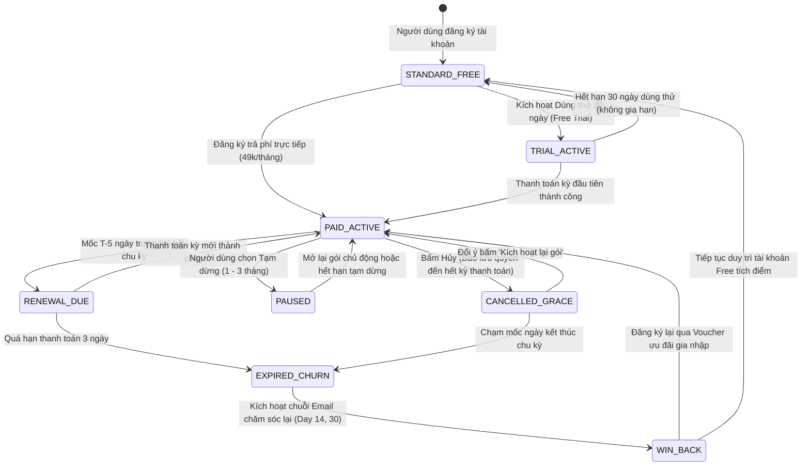
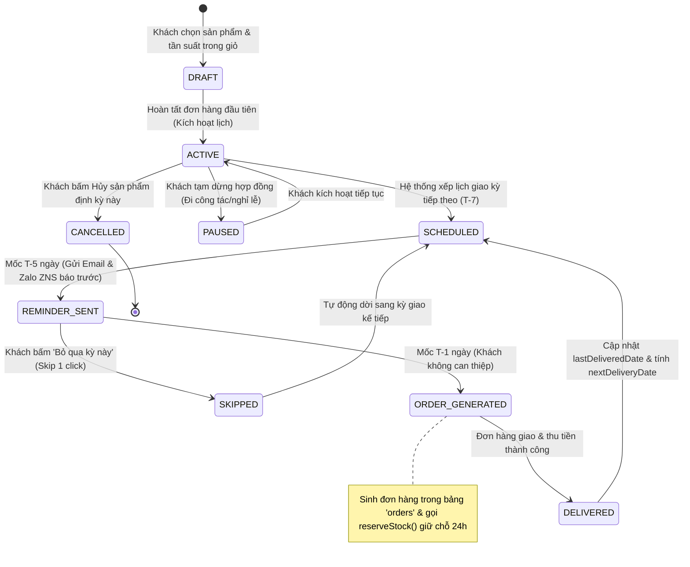

# TÀI LIỆU THIẾT KẾ BƯỚC 1: CHƯƠNG TRÌNH HỘI VIÊN & ĐĂNG KÝ ĐỊNH KỲ THÁI SƠN FOODS
# (STEP 1 - ARCHITECTURE & BUSINESS DESIGN: MEMBERSHIP & SUBSCRIBE & SAVE)

> **Mã tài liệu:** `TSF-DOC-MEMBER-STEP1`  
> **Phiên bản:** v1.0.0 (Phase 1 - Step 1 Design)  
> **Trạng thái:** Dự thảo Thiết kế Kỹ thuật & Nghiệp vụ (Chờ Phê duyệt)  
> **Phạm vi:** Hệ thống E-Commerce Thái Sơn Foods (Next.js 16 App Router & Multi-Store PostgreSQL)  
> **Nguyên tắc cốt lõi:** Không dark patterns, tuân thủ Luật Bảo vệ quyền lợi người tiêu dùng Việt Nam 2023, bảo toàn 100% cơ chế tồn kho và vận hành Core V1.0.

---

## 1. Xung đột và khoảng trống so với code hiện tại

Quá trình đối soát trực tiếp giữa yêu cầu nghiệp vụ Hội viên / Subscribe & Save với toàn bộ mã nguồn hiện hữu của Thái Sơn Foods (`Core V1.0`) xác định 6 xung đột và khoảng trống kỹ thuật cốt lõi sau:

### 1.1. Xung đột cơ chế Giỏ hàng & Quy đổi Biến thể chai (`Bottle Multiplier Engine`)
- **Hiện trạng Code (`src/store/cart.ts`):** Hàm `sanitizeCartProduct` tự động chặn mọi hành vi mua lẻ 1 chai và ép buộc quy đổi về quy cách tối thiểu: Lốc 7 chai (sữa truyền thống) hoặc Lốc 5 chai (dòng YOO). Đồng thời hàm `getItemBottleMultiplier` sử dụng Regex để bóc tách số chai vật lý (`multiplier`).
- **Khoảng trống / Xung đột:** Khi người dùng chọn hình thức **Subscribe & Save (giao định kỳ)**, sản phẩm cần được áp dụng mức giá chiết khấu riêng (ví dụ giảm 10% - 15%), gắn nhãn chu kỳ giao (1 tuần, 2 tuần, 4 tuần) và tách riêng khỏi các sản phẩm mua đơn lẻ thông thường. Nếu đưa trực tiếp vào `CartItem` hiện tại mà không có cờ `subscriptionConfig`, hệ thống sẽ tính sai tổng tiền và không lưu được kỳ hạn giao định kỳ.
- **Giải pháp kiến trúc:** Mở rộng giao diện `CartItem` với trường tùy chọn `subscription?: { isSubscribed: boolean; cycle: '1_WEEK' | '2_WEEKS' | '4_WEEKS'; discountRate: number }`, bảo đảm hàm `getItemBottleMultiplier` vẫn bóc tách đúng số chai vật lý để trừ kho mà không làm sai lệch nghiệp vụ đóng gói.

### 1.2. Khoảng trống định danh: Khách vãng lai (Guest Checkout) vs Hồ sơ Hội viên
- **Hiện trạng Code (`src/app/thanh-toan/page.tsx`, `src/app/api/orders/route.ts`):** 97.7% đơn hàng trong CSDL được tạo ở chế độ vãng lai (Guest), trường `user_id` bị để `NULL`, chỉ lưu `phone` và `full_name` dạng văn bản thuần trong bảng `orders`.
- **Khoảng trống / Xung đột:** Chương trình Hội viên và Subscribe & Save **bắt buộc** phải gắn với một hồ sơ người dùng định danh duy nhất (`User`) để theo dõi chu kỳ gia hạn, tích lũy điểm thưởng và lưu trữ thẻ/phương thức thanh toán.
- **Giải pháp kiến trúc:** Bổ sung cơ chế "One-Tap Member Onboarding": Khi khách hàng tick chọn đăng ký Member hoặc Subscribe & Save tại trang Checkout, hệ thống tự động khởi tạo tài khoản `User` gắn với số điện thoại đó ngay trong transaction tạo đơn, sinh mã phiên đăng nhập và liên kết `orders.user_id = user.id`.

### 1.3. Xung đột cơ chế Giữ chỗ Tồn kho 24h (`Stock Reservations`)
- **Hiện trạng Code (`src/lib/inventory.ts`, `prisma/schema.prisma`):** Khi đơn hàng phát sinh, hệ thống gọi `reserveStock()` để tăng `reserved` tại chi nhánh và tạo phiếu `stock_reservations` có hạn chót 24 giờ (`expires_at = NOW() + 24 HOURS`). Sau 24h cron job sẽ tự giải phóng.
- **Khoảng trống / Xung đột:** Đơn hàng Subscribe & Save được lên lịch định kỳ trước 7 ngày, 14 ngày hoặc 30 ngày. **Tuyệt đối không được phép giữ chỗ tồn kho ngay khi khách tạo lịch đăng ký**, vì việc này sẽ làm "đóng băng" kho vật lý của chi nhánh trong nhiều tuần, vi phạm quy tắc quay vòng hàng tươi date ngắn.
- **Giải pháp kiến trúc:** Áp dụng mô hình **Just-in-Time (JIT) Stock Reservation**: Lịch Subscribe & Save được lưu trong bảng `subscriptions` và `subscription_schedules` ở trạng thái chờ (`SCHEDULED`). Chỉ trước thời điểm giao hàng dự kiến **24 giờ** (T-24h), hệ thống mới tự động sinh đơn hàng con trong bảng `orders` và kích hoạt hàm `reserveStock()` theo đúng luồng chuẩn của Core V1.0.

### 1.4. Khoảng trống Cổng thanh toán định kỳ (Recurring Billing / Tokenization)
- **Hiện trạng Code (`src/app/thanh-toan/page.tsx:L60`):** Hệ thống chỉ có phương thức thanh toán `cod` (tiền mặt) và `bank_transfer` (chuyển khoản VietQR thủ công). Chưa có bất kỳ SDK cổng thanh toán trực tuyến nào được tích hợp.
- **Khoảng trống / Xung đột:** Mô hình Amazon Prime và Subscribe & Save tiêu chuẩn dựa vào tính năng tự động trừ tiền qua thẻ tín dụng/ví (Tokenization). Nếu không có cổng trừ tiền tự động, tỷ lệ rớt đơn kỳ 2 sẽ rất cao nếu khách quên chuyển khoản.
- **Giải pháp kiến trúc (MVP Phase 1):** 
  - Giai đoạn MVP: Vận hành theo cơ chế **Thông báo trước (Pre-notification) + VietQR động từng kỳ kèm tùy chọn COD**. Trước ngày giao 5 ngày (T-5) và 3 ngày (T-3), hệ thống gửi Email/ZNS kèm link thanh toán VietQR chứa đúng cú pháp mã đơn.
  - Chuẩn bị sẵn kiến trúc trừ tiền tự động: Thiết kế bảng `payment_tokens` để sẵn sàng cắm cổng thanh toán (PayOS / OnePay / MoMo Recurring) ở giai đoạn tiếp theo mà không phải đập đi xây lại CSDL.

### 1.5. Khoảng trống Bộ lập lịch tác vụ nền (Background Worker / Task Scheduler)
- **Hiện trạng Code (`src/app/api/cron/cleanup-reservations/route.ts`):** Toàn bộ dự án chỉ có duy nhất 01 cron job dọn dẹp reservation hết hạn. Hệ thống chưa có Message Queue (Redis/BullMQ) hay Scheduler chuyên dụng.
- **Khoảng trống / Xung đột:** Hệ thống định kỳ bắt buộc phải có tiến trình tự động quét hàng ngày vào khung giờ cố định (ví dụ 06:00 sáng) để: (1) Gửi nhắc lịch giao T-5/T-3, (2) Tạo đơn giao hàng T-1, (3) Thông báo gia hạn thẻ hội viên.
- **Giải pháp kiến trúc:** Xây dựng các Endpoint Cron bảo mật bằng Header Bearer Token tương tự Core V1.0:
  - `POST /api/cron/subscriptions/daily-reminders` (Chạy mỗi sáng lúc 07:00).
  - `POST /api/cron/subscriptions/generate-orders` (Chạy lúc 00:00 hàng ngày để gom đơn ngày mai).

### 1.6. Khoảng trống Phân hệ Khuyến mãi & Tích điểm (Loyalty & Promotion Engine)
- **Hiện trạng Code:** CSDL hoàn toàn không có bảng `vouchers`, `discount_rules`, hay `loyalty_points`. Trang thanh toán không có ô nhập mã giảm giá.
- **Khoảng trống / Xung đột:** Quyền lợi cốt lõi của Hội viên Prime Pass là: Miễn phí giao hàng, giảm giá độc quyền 10-15% cho Subscribe & Save, và tích điểm đổi quà.
- **Giải pháp kiến trúc:** Xây dựng mô hình dữ liệu Hội viên và Điểm thưởng độc lập (`membership_tiers`, `user_memberships`, `loyalty_point_ledger`), tính toán chiết khấu tự động trực tiếp trên Server khi kiểm tra quyền hội viên (`checkMemberBenefits`), không phụ thuộc vào mã giảm giá nhập tay.

---

## 2. Bảng kinh tế đơn vị (Unit Economics)

### 2.1. Bảng Thông số Giả định Đầu vào (Input Assumptions)
> ⚠️ **LƯU Ý:** Các chỉ số tài chính dưới đây là **PLACEHOLDER - CHỜ DOANH NGHIỆP XÁC NHẬN**. Các giả định được xây dựng dựa trên dữ liệu sản phẩm chuẩn (Lốc 7 chai sữa bắp/hạt sen 126k, thùng 12 chai 190k, đơn hàng trung bình loại trừ ngoại lai ~200k).

| Chỉ số đầu vào | Ký hiệu | Giá trị Giả định [PLACEHOLDER - CHỜ DOANH NGHIỆP XÁC NHẬN] | Đơn vị | Ghi chú & Căn cứ tham chiếu |
| :--- | :---: | :---: | :---: | :--- |
| **Giá bán lẻ trung bình đơn (AOV gốc)** | $P$ | **200.000** | VNĐ / đơn | Giá trị giỏ hàng chuẩn (1 lốc 7 chai + 1 lốc 5 chai hoặc 1 thùng 12 chai). |
| **Giá vốn hàng bán (COGS)** | $C_{\text{goods}}$ | **50%** (tương đương 100.000) | % doanh thu | Chi phí nguyên liệu bắp tươi/hạt sen, vỏ chai, tem nhãn tại xưởng. |
| **Chi phí bao bì giữ nhiệt & đá gel** | $C_{\text{pack}}$ | **8.000** | VNĐ / đơn | Túi giữ nhiệt chuyên dụng + đá gel bảo quản lạnh sâu $2^\circ\text{C}-5^\circ\text{C}$. |
| **Chi phí giao hàng thực tế (Last-mile)** | $C_{\text{ship}}$ | **25.000** | VNĐ / đơn | Phí trả cho đội shipper nội bộ hoặc đối tác giao hàng nội thành $\le 6\text{km}$. |
| **Phí ship thu từ khách thường** | $R_{\text{ship\_guest}}$ | **0** (nếu $\ge 200\text{k}$) hoặc **30.000** | VNĐ / đơn | Chính sách hiện hành: Đơn từ 200k được freeship, dưới 200k thu 30k. |
| **Phí gói Hội viên Prime Pass** | $F_{\text{member}}$ | **49.000** | VNĐ / tháng | Khách đóng hàng tháng để nhận Freeship toàn bộ + Quyền Subscribe & Save. |
| **Mức chiết khấu Subscribe & Save** | $D_{\text{sub}}$ | **10% – 15%** | % trên đơn | Chiết khấu trực tiếp trên mỗi kỳ giao hàng định kỳ. |
| **Chi phí gửi tin nhắn ZNS/Email nhắc lịch** | $C_{\text{notif}}$ | **1.000** | VNĐ / đơn | Chi phí Zalo ZNS (300đ/tin x 2 tin) + hạ tầng email. |

---

### 2.2. Ba Kịch bản Mô phỏng Kinh tế Đơn vị trên 01 Khách hàng Hội viên / Tháng

#### Công thức tính toán trên 01 Hội viên trong 1 tháng:
1. $\text{Tổng Doanh thu Hàng} = N \times P \times (1 - D_{\text{sub}})$
2. $\text{Tổng Doanh thu Gói Hội viên} = F_{\text{member}}$
3. $\text{Tổng Doanh thu Gộp} = \text{Doanh thu Hàng} + \text{Doanh thu Gói}$
4. $\text{Tổng Chi phí Hàng (COGS)} = N \times (P \times C_{\text{goods}})$
5. $\text{Tổng Chi phí Đóng gói Chuỗi lạnh} = N \times C_{\text{pack}}$
6. $\text{Tổng Chi phí Giao hàng (Công ty bù 100%)} = N \times C_{\text{ship}}$
7. $\text{Tổng Chi phí Thông báo/Vận hành} = N \times C_{\text{notif}}$
8. $\text{Lợi nhuận Đóng góp (Contribution Margin)} = \text{Tổng Doanh thu Gộp} - \sum \text{Chi phí}$
9. $\text{Biên Lợi nhuận Ròng trên Khách} = \frac{\text{Lợi nhuận Đóng góp}}{\text{Tổng Doanh thu Gộp}} \times 100\%$

---

#### BẢNG SO SÁNH 3 KỊCH BẢN MÔ PHỎNG CHI TIẾT (1 THÁNG / 1 KHÁCH HÀNG):

| Chỉ tiêu tài chính & vận hành | Kịch bản 1: THẬN TRỌNG<br>*(Conservative Case)* | Kịch bản 2: MỤC TIÊU<br>*(Target / Base Case)* | Kịch bản 3: TẤN CÔNG TĂNG TRƯỞNG<br>*(Aggressive Growth Case)* |
| :--- | :---: | :---: | :---: |
| **Tần suất giao định kỳ ($N$)** | **2 đơn / tháng** *(Giao mỗi 2 tuần)* | **4 đơn / tháng** *(Giao đều mỗi tuần)* | **4 đơn / tháng** *(Giao đều mỗi tuần)* |
| **Quy mô giỏ hàng gốc ($P$)** | 200.000đ | 200.000đ | 250.000đ *(Combo lớn gia đình)* |
| **Chiết khấu Subscribe & Save ($D_{\text{sub}}$)** | **10%** (-20.000đ/đơn) | **12%** (-24.000đ/đơn) | **15%** (-37.500đ/đơn) |
| **Phí gói Hội viên thu hàng tháng ($F_{\text{member}}$)** | **49.000đ** | **49.000đ** | **0đ** *(Tháng dùng thử Free Trial)* |
| **1. Doanh thu tiền hàng thực thu** | 360.000đ | 704.000đ | 850.000đ |
| **2. Doanh thu phí hội viên** | 49.000đ | 49.000đ | 0đ |
| **TỔNG DOANH THU THU VỀ** | **409.000đ** | **753.000đ** | **850.000đ** |
| - Chi phí giá vốn hàng bán (COGS - 50%) | 200.000đ | 400.000đ | 500.000đ |
| - Chi phí bao bì giữ lạnh & đá gel (8k/đơn) | 16.000đ | 32.000đ | 32.000đ |
| - Chi phí giao vận bù lỗ Freeship (25k/đơn) | 50.000đ | 100.000đ | 100.000đ |
| - Chi phí thông báo ZNS/SMS (1k/đơn) | 2.000đ | 4.000đ | 4.000đ |
| **TỔNG CHI PHÍ BIẾN ĐỔI** | **268.000đ** | **536.000đ** | **636.000đ** |
| **LỢI NHUẬN ĐÓNG GÓP (CONTRIBUTION MARGIN)** | **+141.000đ** | **+217.000đ** | **+214.000đ** |
| **TỶ SUẤT LỢI NHUẬN ĐÓNG GÓP (%)** | **34.47%** | **28.82%** | **25.18%** |
| **Giá trị khách hàng tiết kiệm được / tháng** | **89.000đ** *(Khách hòa vốn & lãi 40k)* | **195.000đ** *(Khách lãi đậm 146k)* | **250.000đ** *(Khách tiết kiệm tối đa)* |

---

### 2.3. Phân tích Điểm hòa vốn & Rủi ro Biên lợi nhuận
1. **Góc độ Khách hàng:** Khách hàng chỉ cần đặt từ **02 đơn hàng/tháng**, tổng số tiền tiết kiệm được từ chiết khấu (40.000đ) cộng với việc không phải lo phát sinh phí ship đã vượt qua mức phí thành viên 49.000đ/tháng. Đề xuất giá trị (Value Proposition) vô cùng hấp dẫn và dễ thuyết phục.
2. **Góc độ Doanh nghiệp:**
   - Dù chịu chi phí giao hàng lạnh (25k ship + 8k đá gel/túi), doanh nghiệp vẫn đạt lợi nhuận đóng góp dương từ **141.000đ đến 217.000đ trên mỗi hội viên mỗi tháng**.
   - **Rào cản an toàn tài chính (Safety Guardrail):** Tuyệt đối **không áp dụng Subscribe & Save cho đơn hàng dưới 120.000đ** (quy cách dưới 1 lốc). Nếu khách chỉ mua 1 lốc 5 chai (100.000đ) mà freeship 25k + túi 8k, biên lợi nhuận đóng góp sẽ bị âm. Bắt buộc giữ ngưỡng giỏ hàng tối thiểu $\ge 120.000\text{đ}$ cho đơn định kỳ.

---

## 3. Thiết kế kiến trúc (Architecture Design)

### 3.1. Prisma Schema Diff (Định dạng Văn bản Diff - Tuyệt đối không chỉnh sửa file gốc)

```diff
Index: prisma/schema.prisma
===================================================================
--- prisma/schema.prisma (Current Architecture Core V1.0)
+++ prisma/schema.prisma (Member & Subscription Extension)
@@ -298,3 +298,125 @@
   @@map("admin_users")
 }
 
+// ─── PHÂN HỆ HỘI VIÊN & ĐĂNG KÝ GIAO ĐỊNH KỲ (PHASE 1) ───────────
+
+/// Hạng thành viên (Standard Free vs Prime Pass)
+model MembershipTier {
+  id            String           @id @default(cuid())
+  code          String           @unique // FREE, PRIME_MONTHLY, PRIME_YEARLY
+  name          String
+  price         Int              @default(0) // 0đ, 49.000đ, 499.000đ
+  billingCycle  String           @default("month") // none, month, year
+  discountRate  Float            @default(0.0) // 0.0, 0.10, 0.15
+  freeShipping  Boolean          @default(false)
+  pointRate     Float            @default(1.0) // Hệ số tích điểm (1.0x, 2.0x)
+  description   String?
+  isActive      Boolean          @default(true) @map("is_active")
+  createdAt     DateTime         @default(now()) @map("created_at")
+  updatedAt     DateTime         @updatedAt @map("updated_at")
+  userMemberships UserMembership[]
+
+  @@map("membership_tiers")
+}
+
+/// Trạng thái gói hội viên của từng người dùng
+model UserMembership {
+  id             String         @id @default(cuid())
+  userId         String         @map("user_id")
+  tierId         String         @map("tier_id")
+  tier           MembershipTier @relation(fields: [tierId], references: [id])
+  status         String         @default("ACTIVE") // TRIAL, ACTIVE, RENEWAL_DUE, PAUSED, CANCELLED_GRACE, EXPIRED
+  startedAt      DateTime       @default(now()) @map("started_at")
+  expiresAt      DateTime       @map("expires_at")
+  autoRenew      Boolean        @default(false) @map("auto_renew")
+  cancelledAt    DateTime?      @map("cancelled_at")
+  cancelReason   String?        @map("cancel_reason")
+  pausedUntil    DateTime?      @map("paused_until")
+  createdAt      DateTime       @default(now()) @map("created_at")
+  updatedAt      DateTime       @updatedAt @map("updated_at")
+
+  @@index([userId])
+  @@index([status, expiresAt])
+  @@map("user_memberships")
+}
+
+/// Hợp đồng đăng ký giao định kỳ Subscribe & Save
+model Subscription {
+  id                 String                 @id @default(cuid())
+  subscriptionCode   String                 @unique @map("subscription_code") // SUB-xxxx
+  userId             String                 @map("user_id")
+  status             String                 @default("ACTIVE") // ACTIVE, PAUSED, CANCELLED
+  deliveryFrequency  String                 @default("1_WEEK") @map("delivery_frequency") // 1_WEEK, 2_WEEKS, 4_WEEKS
+  preferredDayOfWeek Int                    @default(2) @map("preferred_day_of_week") // 2 (Thứ Hai) .. 8 (Chủ Nhật)
+  preferredTimeSlot  String                 @default("08:00-12:00") @map("preferred_time_slot")
+  recipientName      String                 @map("recipient_name")
+  recipientPhone     String                 @map("recipient_phone")
+  shippingAddress    String                 @map("shipping_address")
+  province           String
+  district           String
+  ward               String
+  storeCode          String?                @map("store_code") // Chi nhánh phục vụ cố định
+  paymentMethod      String                 @default("vietqr") @map("payment_method") // vietqr, cod, token
+  nextDeliveryDate   DateTime               @map("next_delivery_date")
+  lastDeliveredDate  DateTime?              @map("last_delivered_date")
+  cancelReason       String?                @map("cancel_reason")
+  createdAt          DateTime               @default(now()) @map("created_at")
+  updatedAt          DateTime               @updatedAt @map("updated_at")
+  items              SubscriptionItem[]
+  schedules          SubscriptionSchedule[]
+
+  @@index([userId])
+  @@index([status, nextDeliveryDate])
+  @@map("subscriptions")
+}
+
+/// Danh mục sản phẩm trong đơn định kỳ
+model SubscriptionItem {
+  id             String       @id @default(cuid())
+  subscriptionId String       @map("subscription_id")
+  subscription   Subscription @relation(fields: [subscriptionId], references: [id], onDelete: Cascade)
+  productId      String       @map("product_id")
+  variantId      String?      @map("variant_id")
+  name           String
+  unit           String       @default("Lốc 7 chai")
+  priceSnapshot  Int          @map("price_snapshot") // Giá niêm yết tại lúc ký
+  discountRate   Float        @default(0.15) @map("discount_rate") // Mức giảm (VD 15%)
+  finalPrice     Int          @map("final_price")
+  quantity       Int          @default(1)
+
+  @@map("subscription_items")
+}
+
+/// Lịch sử từng kỳ giao hàng và trạng thái tạo đơn
+model SubscriptionSchedule {
+  id             String       @id @default(cuid())
+  subscriptionId String       @map("subscription_id")
+  subscription   Subscription @relation(fields: [subscriptionId], references: [id], onDelete: Cascade)
+  scheduledDate  DateTime     @map("scheduled_date")
+  status         String       @default("SCHEDULED") // SCHEDULED, REMINDER_SENT, ORDER_GENERATED, SKIPPED, CANCELLED
+  generatedOrderId String?    @map("generated_order_id") // Liên kết bảng orders khi đã tạo đơn
+  skipReason     String?      @map("skip_reason")
+  reminderSentAt DateTime?    @map("reminder_sent_at")
+  createdAt      DateTime     @default(now()) @map("created_at")
+  updatedAt      DateTime     @updatedAt @map("updated_at")
+
+  @@unique([subscriptionId, scheduledDate])
+  @@index([status, scheduledDate])
+  @@map("subscription_schedules")
+}
+
+/// Sổ cái điểm thưởng thành viên (Loyalty Ledger)
+model LoyaltyPointLedger {
+  id          String   @id @default(cuid())
+  userId      String   @map("user_id")
+  points      Int      // Dương (cộng điểm) hoặc Âm (tiêu điểm)
+  balanceAfter Int     @map("balance_after")
+  sourceType  String   @map("source_type") // ORDER_REWARD, SIGNUP_BONUS, REDEEM_DISCOUNT, EXPIRED
+  referenceId String?  @map("reference_id") // Mã đơn hàng hoặc mã khuyến mãi
+  description String
+  createdAt   DateTime @default(now()) @map("created_at")
+
+  @@index([userId, createdAt])
+  @@map("loyalty_point_ledger")
+}
```

---

### 3.2. Danh sách RESTful API Đặc tả

| Nhóm chức năng | Phương thức & Tuyến đường (Endpoint) | Quyền hạn (RBAC) | Diễn giải chức năng nghiệp vụ |
| :--- | :--- | :---: | :--- |
| **Gói Hội viên** | `GET /api/membership/tiers` | Public | Lấy danh sách các gói thành viên, biểu phí và bảng quyền lợi. |
| **Gói Hội viên** | `POST /api/membership/subscribe` | Customer User | Đăng ký gói (Dùng thử 30 ngày hoặc trả phí tháng/năm). |
| **Gói Hội viên** | `GET /api/membership/my-status` | Customer User | Xem thông tin gói hiện tại, ngày hết hạn, số tiền đã tiết kiệm. |
| **Gói Hội viên** | `POST /api/membership/pause` | Customer User | Tạm dừng gói từ 1 đến 3 tháng (bảo lưu ưu đãi, không phát sinh phí). |
| **Gói Hội viên** | `POST /api/membership/cancel` | Customer User | **Hủy gia hạn 2 bước không dark pattern**: Bảo lưu quyền đến hết kỳ. |
| **Đăng ký Định kỳ**| `POST /api/subscriptions` | Customer User | Khởi tạo hợp đồng Subscribe & Save mới từ giỏ hàng. |
| **Đăng ký Định kỳ**| `GET /api/subscriptions` | Customer User | Xem danh sách tất cả các sản phẩm đang đăng ký giao định kỳ. |
| **Đăng ký Định kỳ**| `PUT /api/subscriptions/[id]/skip` | Customer User | Bỏ qua kỳ giao tiếp theo (Skip current scheduled delivery). |
| **Đăng ký Định kỳ**| `PUT /api/subscriptions/[id]/frequency` | Customer User | Đổi chu kỳ (1 tuần, 2 tuần, 4 tuần) hoặc đổi ngày giao trong tuần. |
| **Đăng ký Định kỳ**| `DELETE /api/subscriptions/[id]` | Customer User | Hủy đăng ký sản phẩm định kỳ (1 click xác nhận, không cản trở). |
| **Hệ thống Cron** | `POST /api/cron/subscriptions/reminders` | CRON_SECRET | Tác vụ chạy 07:00: Gửi thông báo Email/ZNS nhắc lịch giao T-5 và T-3. |
| **Hệ thống Cron** | `POST /api/cron/subscriptions/generate-orders` | CRON_SECRET | Tác vụ chạy 00:00: Sinh đơn `orders` thực tế & giữ chỗ kho cho ngày mai. |
| **Quản trị Admin** | `GET /api/admin/members` | SUPER_ADMIN | Xem danh sách hội viên, phân loại thẻ, lọc theo doanh thu lũy kế. |
| **Quản trị Admin** | `GET /api/admin/subscriptions` | STORE_STAFF | Cửa hàng xem danh sách đơn định kỳ sắp tới để chuẩn bị tồn kho. |

---

### 3.3. Máy trạng thái Thành viên (Member State Machine)



---

### 3.4. Máy trạng thái Dòng Đăng ký Định kỳ (Subscription Order Line State Machine)



---

## 4. Wireframe cho các màn hình (UI/UX Wireframes)

### 4.1. Màn hình Chi tiết Sản phẩm & Giỏ hàng: Khối chọn Subscribe & Save
*Vị trí: Ngay dưới khu vực chọn biến thể lốc/thùng trên Trang sản phẩm và trong Giỏ hàng.*

```
┌────────────────────────────────────────────────────────────────────────┐
│  SỮA BẮP NẾP TƯƠI THÁI SƠN (LỐC 7 CHAI 330ML)                          │
│  Quy cách: Lốc 7 chai • Bảo quản lạnh 2°C - 5°C                        │
├────────────────────────────────────────────────────────────────────────┤
│  LỰA CHỌN MUA HÀNG:                                                    │
│                                                                        │
│  ○ MUA MỘT LẦN (GIAO NGAY)                                             │
│    Giá niêm yết: 126.000 đ                                             │
│                                                                        │
│  ● GIAO ĐỊNH KỲ (SUBSCRIBE & SAVE) — TIẾT KIỆM 15%                     │
│    ┌──────────────────────────────────────────────────────────────┐    │
│    │  Giá thành viên: 107.100 đ / lốc (Tiết kiệm 18.900 đ)        │    │
│    │  ✓ Miễn phí vận chuyển 100% với túi giữ nhiệt chuyên dụng    │    │
│    │  ✓ Tự động giao đúng hẹn, không lo hết sữa sáng              │    │
│    │                                                              │    │
│    │  Tần suất giao hàng:                                         │    │
│    │  [ Giao mỗi tuần (Khuyên dùng) ▼ ]                           │    │
│    │    • Giao mỗi 1 tuần                                         │    │
│    │    • Giao mỗi 2 tuần                                         │    │
│    │    • Giao mỗi 4 tuần (1 tháng)                               │    │
│    │                                                              │    │
│    │  Ngày nhận hàng mong muốn: [ Thứ Hai hàng tuần ▼ ]           │    │
│    │  Khung giờ: [ 08:00 - 12:00 (Buổi sáng) ▼ ]                  │    │
│    │                                                              │    │
│    │  ℹ️ Bạn có thể đổi vị, bỏ qua kỳ hoặc hủy bất kỳ lúc nào     │    │
│    └──────────────────────────────────────────────────────────────┘    │
│                                                                        │
│  [  THÊM VÀO GIỎ ĐĂNG KÝ GIAO ĐỊNH KỲ  ]                               │
└────────────────────────────────────────────────────────────────────────┘
```

---

### 4.2. Màn hình Đăng ký / Nâng cấp Hội viên (Prime Pass Modal)

```
┌────────────────────────────────────────────────────────────────────────┐
│                        THÀNH VIÊN THÁI SƠN PRIME                       │
│           Uống Đồ Tươi Mỗi Ngày • Tiết Kiệm Tối Đa Cả Năm              │
├────────────────────────────────────────────────────────────────────────┤
│  BẢNG SO SÁNH ĐẶC QUYỀN:                                               │
│                                                                        │
│  Đặc quyền dịch vụ             Khách Thường        Hội Viên PRIME      │
│  ────────────────────────────────────────────────────────────────────  │
│  • Tích điểm mua hàng          1% đơn hàng         2% đơn hàng (x2)    │
│  • Phí giao hàng               30k (Đơn < 200k)    MIỄN PHÍ 100%       │
│  • Giảm giá Subscribe & Save   Không áp dụng       GIẢM 15% TRỌN ĐỜI   │
│  • Quà tặng sinh nhật          Không có            Hộp quà dinh dưỡng  │
│  • Ưu tiên giao giờ cao điểm   Tiêu chuẩn          Giao ưu tiên 1-2h   │
│                                                                        │
├────────────────────────────────────────────────────────────────────────┤
│  CHỌN GÓI HỘI VIÊN:                                                    │
│                                                                        │
│  ┌─────────────────────────────────┐  ┌─────────────────────────────┐  │
│  │ ○ GÓI THÁNG                     │  │ ● GÓI NĂM (TIẾT KIỆM 15%)   │  │
│  │   49.000 đ / tháng              │  │   499.000 đ / năm           │  │
│  │   Thanh toán định kỳ hàng tháng │  │   Chỉ ~41.000 đ / tháng     │  │
│  └─────────────────────────────────┘  └─────────────────────────────┘  │
│                                                                        │
│  🎁 ƯU ĐÃI ĐẶC BIỆT: DÙNG THỬ 30 NGÀY HOÀN TOÀN MIỄN PHÍ               │
│                                                                        │
│  [ DÙNG THỬ 30 NGÀY MIỄN PHÍ - KHÔNG RÀNG BUỘC ]                       │
│                                                                        │
│  Cam kết minh bạch: Hủy dễ dàng trong 1 click tại trang cá nhân        │
│  bất kỳ lúc nào trước ngày 30 mà không mất bất kỳ chi phí nào.         │
│                                                                        │
│  [ Tiếp tục mua hàng với tư cách Khách Thường ] (Nút đóng rõ ràng)     │
└────────────────────────────────────────────────────────────────────────┘
```

---

### 4.3. Màn hình Quản lý Thành viên (Member Dashboard)

```
┌────────────────────────────────────────────────────────────────────────┐
│  TRANG CÁ NHÂN > THÀNH VIÊN CỦA TÔI                                    │
├────────────────────────────────────────────────────────────────────────┤
│  Xin chào, NGUYỄN VĂN A                                                │
│  Hạng thẻ: HỘI VIÊN THÁI SƠN PRIME  [ ĐANG HOẠT ĐỘNG ]                 │
│  Ngày gia hạn tiếp theo: 28/11/2026 (Còn 24 ngày)                      │
│                                                                        │
│  ┌──────────────────────┐  ┌──────────────────┐  ┌──────────────────┐  │
│  │ ĐÃ TIẾT KIỆM ĐƯỢC    │  │ ĐIỂM THƯỞNG HIỆN CÓ│  │ ĐƠN ĐỊNH KỲ ĐANG│  │
│  │ 245.000 đ            │  │ 480 điểm (~48k)  │  │ CHẠY: 2 HỢP ĐỒNG │  │
│  └──────────────────────┘  └──────────────────┘  └──────────────────┘  │
│                                                                        │
│  QUẢN LÝ QUYỀN LỢI & GÓI DỊCH VỤ:                                      │
│  • Phương thức thanh toán gia hạn: Chuyển khoản VietQR nhắc trước      │
│  • Trạng thái nhận tin Zalo ZNS / Email: [ Đang bật ✓ ]                │
│                                                                        │
│  [ Quản lý lịch giao Subscribe & Save ]   [ Tạm dừng gói (1-3 tháng) ] │
│                                                                        │
│  ────────────────────────────────────────────────────────────────────  │
│  [ HỦY GÓI THÀNH VIÊN ] (Nút văn bản rõ ràng, không ẩn giấu)           │
└────────────────────────────────────────────────────────────────────────┘
```

---

### 4.4. Màn hình Quản lý Lịch giao Định kỳ (Subscription Hub)

```
┌────────────────────────────────────────────────────────────────────────┐
│  LỊCH GIAO HÀNG ĐỊNH KỲ CỦA TÔI (SUBSCRIBE & SAVE)                     │
├────────────────────────────────────────────────────────────────────────┤
│  HỢP ĐỒNG #SUB-1084 — [ ĐANG HOẠT ĐỘNG ]                               │
│  Địa chỉ giao: 123 Nguyễn Thị Thập, P. Tân Phú, Quận 7, TP.HCM         │
│  Chu kỳ: Giao mỗi tuần vào Thứ Hai (08:00 - 12:00)                     │
│                                                                        │
│  DANH SÁCH SẢN PHẨM GIAO KỲ TỚI (Thứ Hai, 16/10/2026):                 │
│  1. Sữa Bắp Nếp Tươi (Lốc 7 chai)    x 1 lốc   107.100 đ (-15%)        │
│  2. Sữa Hạt Sen Mekong (Lốc 7 chai)  x 1 lốc   107.100 đ (-15%)        │
│  ────────────────────────────────────────────────────────────────────  │
│  Tổng thanh toán kỳ tới: 214.200 đ (Đã tiết kiệm 37.800 đ + Freeship)  │
│                                                                        │
│  THAO TÁC NHANH CHO KỲ GIAO 16/10/2026:                                │
│  ┌────────────────────────┐  ┌─────────────────┐  ┌─────────────────┐  │
│  │ [ BỎ QUA KỲ NÀY ]      │  │ [ ĐỔI NGÀY GIAO ]│  │ [ THÊM/BỚT MÓN ]│  │
│  │ (Dời sang 23/10)       │  │ (Chọn ngày khác)│  │ (Đổi vị sữa)    │  │
│  └────────────────────────┘  └─────────────────┘  └─────────────────┘  │
│                                                                        │
│  [ Tạm dừng nhận hàng 1 tháng ]         [ Hủy hợp đồng định kỳ này ]   │
└────────────────────────────────────────────────────────────────────────┘
```

---

### 4.5. Màn hình Hủy gói Minh bạch (Ethical 2-Step Cancellation)
*Quy chuẩn bắt buộc: Hoàn tất trong 2 bước, không bắt gọi điện, không gây nhầm lẫn.*

#### Bước 1: Màn hình Thông tin Quyền lợi & Giải pháp thay thế (Không ép buộc)
```
┌────────────────────────────────────────────────────────────────────────┐
│                      BẠN ĐANG YÊU CẦU HỦY GÓI PRIME                    │
├────────────────────────────────────────────────────────────────────────┤
│  Thông tin quyền lợi của bạn:                                          │
│  • Bạn đã là thành viên gắn bó được: 3 tháng                           │
│  • Tổng số tiền bạn đã tiết kiệm được: 485.000 đ                       │
│  • Gói hiện tại của bạn vẫn còn giá trị đến hết ngày: 28/11/2026       │
│                                                                        │
│  Nếu bạn sắp đi công tác hoặc chưa có nhu cầu uống sữa thời gian tới,   │
│  bạn có thể chọn các giải pháp linh hoạt sau:                          │
│                                                                        │
│  ┌──────────────────────────────────────────────────────────────────┐  │
│  │ [1] TẠM DỪNG GÓI 1 ĐẾN 3 THÁNG                                   │  │
│  │ Giữ nguyên mức ưu đãi 15% và điểm thưởng, không phát sinh chi phí│  │
│  │ [ Tạm dừng 1 tháng ]   [ Tạm dừng 2 tháng ]   [ Tạm dừng 3 tháng ]│  │
│  └──────────────────────────────────────────────────────────────────┘  │
│                                                                        │
│  ┌──────────────────────────────────────────────────────────────────┐  │
│  │ [2] CHUYỂN SANG GIAO THƯA HƠN (2 TUẦN HOẶC 4 TUẦN / LẦN)          │  │
│  │ [ Điều chỉnh tần suất giao hàng ]                                │  │
│  └──────────────────────────────────────────────────────────────────┘  │
│                                                                        │
│  Hai nút bấm hiển thị ngang hàng với độ tương phản rõ ràng:            │
│  [ GIỮ LẠI GÓI HỘI VIÊN ]            [ TIẾP TỤC ĐẾN BƯỚC HỦY CUỐI > ]  │
└────────────────────────────────────────────────────────────────────────┘
```

#### Bước 2: Xác nhận Hủy cuối cùng & Khảo sát 1 chạm
```
┌────────────────────────────────────────────────────────────────────────┐
│                      XÁC NHẬN HỦY GIA HẠN HỘI VIÊN                     │
├────────────────────────────────────────────────────────────────────────┤
│  Hãy cho Thái Sơn Foods biết lý do bạn muốn dừng (Tùy chọn, 1 click): │
│  ( ) Giá cước chưa phù hợp với nhu cầu                                 │
│  ( ) Tần suất giao quá nhiều, uống không kịp date sữa hạt nấu tươi     │
│  ( ) Muốn đổi sang dùng gói mua lẻ khi cần                             │
│  ( ) Lý do khác: [.................................................]  │
│                                                                        │
│  CAM KẾT CỦA CHÚNG TÔI:                                                │
│  ✓ Bạn KHÔNG bị trừ tiền ở kỳ tiếp theo.                               │
│  ✓ Bạn vẫn được hưởng trọn vẹn quyền lợi Freeship và giảm giá 15%      │
│    cho đến hết ngày 28/11/2026.                                        │
│  ✓ Sau ngày 28/11/2026, tài khoản tự động chuyển về Khách Thường.     │
│                                                                        │
│  [ QUAY LẠI ]                           [ XÁC NHẬN HỦY GIA HẠN ]       │
└────────────────────────────────────────────────────────────────────────┘
```

---

## 5. Phương án xác minh số điện thoại

Số điện thoại là khóa định danh khách hàng cốt lõi tại Việt Nam. Dưới đây là phân tích chi tiết 3 phương án xác minh:

| Tiêu chí so sánh | Phương án 1: SMS OTP Brandname truyền thống | Phương án 2: Zalo ZNS OTP (Đề xuất khuyên dùng) | Phương án 3: Xác minh Hybrid (Email Magic Link + Gọi xác nhận đơn đầu) |
| :--- | :--- | :--- | :--- |
| **Cơ chế hoạt động** | Gửi tin nhắn SMS chứa mã 6 số qua Telco Gateway (Viettel, VinaPhone, MobiFone qua eSMS/SpeedSMS). | Gửi mã OTP trực tiếp vào ứng dụng Zalo của khách qua Zalo OA đã tick vàng của Thái Sơn Foods. | Đăng ký bằng Email + Mật khẩu/Google OAuth; nhập SĐT và nhân viên/CallBot gọi xác nhận tại đơn đầu tiên. |
| **Chi phí trên mỗi OTP** | **Cao:** $400 - 700\text{ đ} / \text{tin}$ SMS Brandname. | **Tiết kiệm:** $200 - 300\text{ đ} / \text{tin}$ ZNS (rẻ hơn 50-60%). | **Rất thấp:** Miễn phí gửi Email (Gmail SMTP hiện có), tốn cước viễn thông gọi thoại. |
| **Trải nghiệm người dùng** | Rất quen thuộc, nhận được trên mọi dòng điện thoại (kể cả Feature phone). | Cực kỳ mượt mà, thông báo đẩy (Push Notification) tức thì trên Zalo, copy mã trong 1 chạm. | Phải mở hộp thư Email lấy link kích hoạt, gây ma sát (friction) cao cho khách mua hàng trên di động. |
| **Rủi ro Bảo mật & Quyền riêng tư** | - **Gian lận SMS Toll Fraud:** Rủi ro bot nước ngoài/tool tự động spam gửi OTP làm cạn sạch ngân sách.<br>- Giao thức SMS không mã hóa đầu cuối, nguy cơ lộ OTP trên màn hình khóa. | - **Bảo mật cao:** Gửi qua hạ tầng mã hóa của Zalo, chỉ tài khoản Zalo chính chủ gắn với SĐT mới xem được.<br>- Ngăn chặn 100% rủi ro bot spam từ IP nước ngoài. | - Khách có thể nhập bừa số điện thoại của người khác để nhận ưu đãi mà không bị chặn ở bước đăng ký.<br>- Rủi ro sai lệch dữ liệu PII. |
| **Hạn chế kỹ thuật** | Phụ thuộc sóng nhà mạng, đôi khi bị nghẽn tin nhắn trong giờ cao điểm. | Yêu cầu khách hàng có cài đặt và sử dụng ứng dụng Zalo trên số điện thoại đó. | Tốn nhân lực vận hành gọi xác nhận, không thể tự động hóa 100%. |

### 👉 PHƯƠNG ÁN MẶC ĐỊNH ĐƯỢC ĐỀ XUẤT (DEFAULT RECOMMENDATION):
**Mô hình Phối hợp Hai tầng (Zalo ZNS OTP làm Kênh chính + SMS Brandname làm Kênh Dự phòng - Fallback):**
1. **Tầng 1 (Ưu tiên số 1):** Khi khách bấm "Gửi mã xác nhận", hệ thống tự động ưu tiên gửi qua **Zalo ZNS OTP** (Tỷ lệ người dùng smartphone tại TP.HCM dùng Zalo đạt $>90\%$, chi phí tiết kiệm 60%, tốc độ nhận dưới 3 giây).
2. **Tầng 2 (Dự phòng Failover):** Nếu sau **45 giây** cổng Zalo báo lỗi (khách chưa kích hoạt Zalo trên SĐT đó), hệ thống tự động kích hoạt nút "Gửi mã qua tin nhắn SMS truyền thống".
3. **Cơ chế Chống lạm dụng (Anti-Abuse Guardrails):**
   - Giới hạn tối đa 03 mã OTP / 01 số điện thoại / 24 giờ.
   - Khoảng cách tối thiểu giữa 2 lần gửi mã là 60 giây.
   - Bắt buộc vượt qua Captcha vô hình (Cloudflare Turnstile) trước khi kích hoạt lệnh gửi OTP để chống bot cày tiền SMS.

---

## 6. Việc doanh nghiệp cần quyết định

Bảng tổng hợp các quyết định chiến lược và chính sách bắt buộc Ban Giám Đốc Thái Sơn Foods cần phê duyệt trước khi chuyển sang giai đoạn phát triển tính năng (Bước 2):

| STT | Nội dung công việc Doanh nghiệp cần Quyết định | Mức độ Ưu tiên | Phòng ban Phụ trách | Tác động Kỹ thuật / Tài chính nếu chưa có quyết định |
| :---: | :--- | :---: | :---: | :--- |
| **1** | **Chốt Biểu phí Hội viên & Thời gian Dùng thử:** Phê duyệt mức phí chính thức (Đề xuất: 49.000đ/tháng, 499.000đ/năm) và thời gian Free Trial (30 ngày hay 14 ngày). | 🔴 **CAO** | Ban Giám Đốc / Marketing | Cần số liệu cứng để cấu hình bảng `membership_tiers` và giao diện thanh toán. |
| **2** | **Cung cấp Bảng Giá vốn Chuẩn (`cost_price`):** Cung cấp giá thành phẩm xuất xưởng của 12 SKU và 12 Combo để xác định biên lợi nhuận chính xác. | 🔴 **CAO** | Kế toán / Thu mua | Tránh rủi ro bán lỗ khi cộng dồn chiết khấu 15% Subscribe & Save và Freeship. |
| **3** | **Lựa chọn Đơn vị Cung cấp Cổng OTP (Zalo ZNS / SMS):** Ký hợp đồng dịch vụ gửi tin OTP với VNG Zalo Cloud Account hoặc đơn vị SMS Gateway (eSMS/SpeedSMS). | 🔴 **CAO** | CNTT / Vận hành | Thiếu tài khoản và Secret Key để tích hợp API gửi mã xác thực số điện thoại. |
| **4** | **Chiến lược Cổng thanh toán Tự động (Auto-Debit):** Quyết định chọn đối tác cổng thanh toán cho giai đoạn tiếp theo (PayOS, OnePay, MoMo, VNPay). | 🟡 **TRUNG BÌNH** | Ban Giám Đốc / Tài chính | Ảnh hưởng đến việc thiết kế API Webhook trừ tiền tự động ở Phase 2. |
| **5** | **Phê duyệt Điều khoản Dịch vụ Hội viên (T&C):** Thẩm định pháp lý bản Điều khoản hội viên, chính sách hủy và hoàn tiền theo Luật BVQLNTD 2023. | 🟡 **TRUNG BÌNH** | Pháp chế / Giám đốc | Bắt buộc phải công bố công khai trên website trước khi thu tiền người dùng. |
| **6** | **Quy trình Phân công Giao hàng Định kỳ tại Cửa hàng:** Thống nhất quy trình cửa hàng nhận đơn định kỳ vào đầu ngày và phân công shipper chi nhánh. | 🟡 **TRUNG BÌNH** | Quản lý Chuỗi Cửa hàng | Đảm bảo tỷ lệ giao đúng hẹn 100% cho hội viên Prime. |
| **7** | **Chính sách Tích điểm & Đổi quà:** Quy định tỷ lệ quy đổi điểm (ví dụ: 100 điểm = 10.000đ trừ vào đơn hàng tiếp theo hay đổi quà hiện vật). | 🟢 **THẤP** | Marketing | Có thể triển khai sau ở phiên bản mở rộng (Phase 2), không chặn MVP. |
